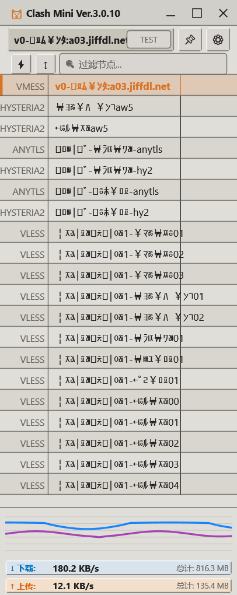
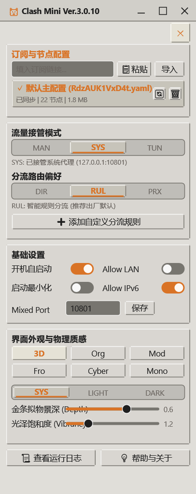
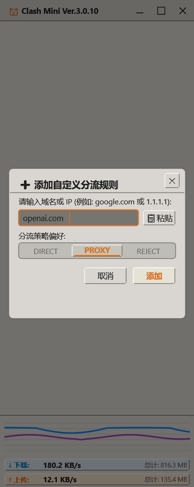
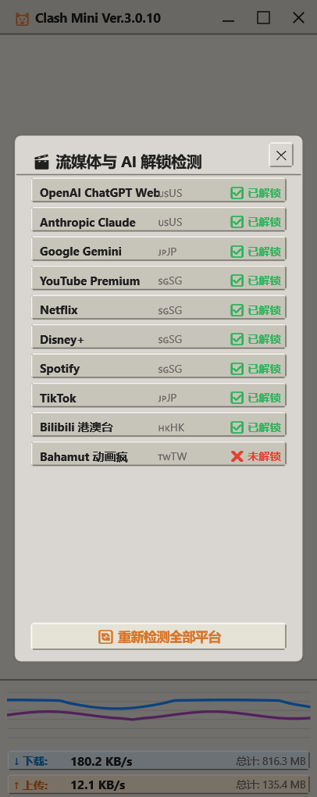

# Clash Win

[](https://github.com/qiu-yuxiao/clash-win/releases/latest)
[](https://github.com/qiu-yuxiao/clash-win/releases)
[](https://www.gnu.org/licenses/gpl-3.0)
[](https://isocpp.org)
[](https://github.com/qiu-yuxiao/clash-win)

> **Clash Win v0.2.2** — the pure Windows native C++ rewrite of Clash Mini.
> Zero web engine. Zero JavaScript runtime. Built with Win32 API, Direct2D/DirectWrite, and modern C++20.

Clash Win keeps everything you love about Clash Mini — the minimalist zero-config workflow, the 3D skeuomorphic visuals, the auto node switching and rule updates — but replaces the Tauri/WebView layer with hand-written native rendering. The result: a single native executable with no bundled browser engine and no JavaScript runtime, with behavior aligned 1:1 to the source it ports (see [Known Limitations](docs/KNOWN_LIMITATIONS_0.2.2.md) for the differences registered in v0.2.2).

> [!NOTE]
> **v0.2.2 still carries explicitly registered gaps** — frosted-glass Blur, hover interpolation, an in-app update channel, code signing (the release assets are unsigned, no Authenticode signature), and clean-machine acceptance are documented in [KNOWN_LIMITATIONS_0.2.2.md](docs/KNOWN_LIMITATIONS_0.2.2.md). It is not claimed to be a perfect 1:1 copy.

---

## Quick Start Guide

> **Core Value**: Minimalist, zero-threshold, out-of-the-box — same philosophy as Clash Mini.

### Getting Started
Click the [Gear] button in the upper right corner of Clash Win, paste your subscription link or node configuration (supporting 19 protocols) into the "Subscription Link/Node Config" field, click [Import Node Info], and wait for the proxy node to be activated.

### Client Configuration
* **Browsers**: You can start browsing the web directly after importing the nodes (system proxy is set automatically).
* **Other Client Apps**: Most apps can access the internet directly. For the few that cannot, manually set their proxy address to `127.0.0.1` with port `10802` (SOCKS) or `10803` (HTTP).
* **Global Proxy**: If an app has no manual proxy option, enable Clash Win's **TUN Mode**.

> [!NOTE]
> **What is [TUN Mode]?**
> It creates a system virtual network adapter to fully hijack all network traffic. It is suitable for region-locked games, command-line terminals, and other software that ignores system proxy settings.
> *TUN mode consumes more resources and is prone to conflicts. Unless you have the specific needs above, the default settings are sufficient.*

### Key Features
* **[Auto Switch]**: Speed-tests and switches to the fastest node automatically after importing or switching subscriptions; avoids congested or failed nodes in real time.
* **[Rule Updates]**: Integrates popular rule sets and GeoIP databases, kept synced automatically.
* **[Mini-Monitoring]**: Shrink the window to its minimum size and Clash Win becomes a compact traffic meter.
* **[Right-Click Routing]**: Right-click any domain in the connection list to direct-connect, proxy, or reject (maximize the window to use).
* **[100% Native]**: No Chromium, no WebView2, no JS runtime — a single native executable.

---

## 快速开始指南

> **核心价值**：极简、零门槛、开箱即用，与 Clash Mini 相同的理念。

### 开始使用
点击 Clash Win 右上角的 [齿轮] 按钮，将订阅链接/节点配置（支持 19 种协议）粘贴到"订阅链接/节点配置"输入框，点击 [导入节点信息]，等待代理节点激活即可。

### 客户端配置
* **浏览器**：导入节点后即可直接浏览网页（自动设置系统代理）。
* **其他客户端应用**：大多数应用可直接上网。少数无法直接上网的应用，可手动设置代理地址为 `127.0.0.1`，端口为 `10802`（SOCKS）或 `10803`（HTTP）。
* **全局代理**：如果软件没有手动代理配置选项，请启用 Clash Win 的 **TUN 模式**。

### 核心功能
* **[自动切换]**：导入或切换订阅后自动测速并切换到最快节点；实时避开拥堵或失效节点。
* **[规则更新]**：集成流行规则集和 GeoIP 数据库，自动同步更新。
* **[迷你监控]**：将窗口缩小至最小尺寸，应用变为小巧的流量监控器。
* **[右键路由]**：在连接列表中右键任意域名，可直连、代理或拒绝（需最大化窗口）。
* **[100% 原生]**：无 Chromium、无 WebView2、无 JS 运行时，单一原生可执行文件。

---

## Download & Installation / 下载与安装

Get the artifacts from the [Releases page](https://github.com/qiu-yuxiao/clash-win/releases). Each Release ships two Windows x64 builds plus checksums:

| Artifact / 产物 | Form / 形态 | Notes / 说明 |
| :--- | :--- | :--- |
| `ClashWin_<version>_x64-setup.exe` | NSIS installer / 安装版 | per-machine (`Program Files`), **requires a UAC prompt** at install time; installs/shares `clash_verge_service` / 安装时需 UAC 授权，安装或共用 Windows 服务 |
| `ClashWin_<version>_x64_portable.zip` | Portable / 便携版 | extract & run, `.config/PORTABLE` included, no installer, no registry writes / 解压即用、不写注册表 |
| `SHA256SUMS.txt` | Checksums / 校验 | SHA256 of both artifacts / 两个产物的 SHA256 |

1. Download either artifact from [Releases](https://github.com/qiu-yuxiao/clash-win/releases) and verify its SHA256 against `SHA256SUMS.txt` before running.
2. **Installer**: double-click, accept the UAC prompt, follow the wizard (Simplified Chinese / English / Русский start language).
3. **Portable**: extract to any folder and run `clashwin.exe`.
4. Import a subscription and you are done. See [Release notes](docs/RELEASE_NOTES_0.2.2.md) for the full v0.2.2 scope.

```powershell
Get-FileHash .\ClashWin_0.2.2_x64-setup.exe -Algorithm SHA256
Get-FileHash .\ClashWin_0.2.2_x64_portable.zip -Algorithm SHA256
```

> [!WARNING]
> **v0.2.2 release assets are unsigned — no Authenticode signature.** The signing step needs an elevated (UAC) session that was unavailable in the non-interactive release environment, so the signature status is recorded but does not block the release. Windows will show "**Unknown publisher**" and SmartScreen may warn on every machine. **Always verify the download against `SHA256SUMS.txt`** — the checksum is the only trust anchor. This matches Clash Mini v3.2.2 installers, which likewise carry no Authenticode signature. See [Known Limitations (d)](docs/KNOWN_LIMITATIONS_0.2.2.md) and [SECURITY.md](SECURITY.md).

---

## System Requirements / 系统要求

| Item | Requirement |
| :--- | :--- |
| OS | **Windows 10 / 11, x64 only** (Clash Win is Windows-native; no Linux/macOS build) |
| Runtime | Direct2D 1.0 / DirectWrite (present on supported Windows versions); no WebView2, no .NET, no Chromium |
| Privileges | Installer form needs administrator rights once (UAC) for per-machine install and service setup; portable form needs none |
| Disk | ~50 MB for the extracted client plus the bundled rules/GeoIP resources |
| Network | A user-supplied subscription / node config; the client itself does not provide proxy servers |

To **build from source** you additionally need Visual Studio 2022 (Desktop development with C++), CMake 3.20+, and NSIS 3.x for the installer — see [CONTRIBUTING.md](CONTRIBUTING.md).

---

## Screenshots

### 1. Main Window — Node List (主窗口 · 节点列表)
<p align="left">
  
</p>

### 2. Settings Drawer (设置抽屉)
<p align="left">
  
</p>

### 3. Subscription Import (订阅导入弹窗)
<p align="left">
  
</p>

### 4. Streaming Unlock (流媒体解锁检测)
<p align="left">
  
</p>

---

## Tech Stack

| Layer | Technology | Description |
| :--- | :--- | :--- |
| **Language** | **Modern C++20** | Strict ISO C++20, RAII, no exceptions in hot paths |
| **Graphics** | **Direct2D & DirectWrite** | Hardware-accelerated vector rendering, 3D bevel skeuomorphic UI, zero web engine |
| **Window Host** | **Pure Win32 API** | Custom frameless window, NCHITTEST hit-testing, WM_SIZING geometry clamping, Per-Monitor v2 DPI |
| **Networking** | **WinHTTP** | Direct REST + WebSocket communication with the Mihomo core |
| **Core Service** | **Win32 SCM API** | Shares the `clash_verge_service` Windows service with Clash Mini / Clash Verge |
| **Build** | **CMake 3.20+ / VS 2022** | `CMakePresets.json` for reproducible configuration |

---

## Building from Source

### Prerequisites
* Windows 10/11 x64
* Visual Studio 2022 (or VS Build Tools) with the "Desktop development with C++" workload
* CMake 3.20+

```powershell
# 1. Configure (Visual Studio 2022 generator, x64)
cmake -B build -G "Visual Studio 17 2022" -A x64

# 2. Build Release
cmake --build build --config Release

# 3. Run
.\build\bin\Release\clashwin.exe
```

The repository ships a large unit-test suite (offscreen pixel assertions included); run `python3 scripts/run_tests_py.py` against the built test target before submitting changes. **A fresh clone compiles but cannot run**: the five `sidecar/*.exe` upstream binaries are not committed (`.gitignore` excludes `*.exe`). See [docs/05-sidecar-内核资产.md](docs/05-sidecar-内核资产.md) and `scripts/verify_sidecar.ps1`.

---

## FAQ & Troubleshooting / 常见问题入口

| Question | Where to look |
| :--- | :--- |
| Where do I download / 在哪下载 | [Releases](https://github.com/qiu-yuxiao/clash-win/releases) |
| Usage, config, subscription import / 使用与配置 | [Wiki](https://github.com/qiu-yuxiao/clash-win/wiki) |
| "Unknown publisher" / SmartScreen warning / 未知发布者 | [Known Limitations (d)](docs/KNOWN_LIMITATIONS_0.2.2.md) · [SECURITY.md](SECURITY.md) |
| Why does a source-only build not run / 源码编译后无法运行 | [Known Limitations (f)](docs/KNOWN_LIMITATIONS_0.2.2.md) |
| "Check for updates" does nothing / 检查更新无反应 | [Known Limitations (c)](docs/KNOWN_LIMITATIONS_0.2.2.md) |
| Ports, service conflicts / 端口与服务冲突 | [Relationship with Clash Mini](#relationship-with-clash-mini-与-clash-mini-的关系) |
| Something else is broken / 其他问题 | [Issues](https://github.com/qiu-yuxiao/clash-win/issues) (please use the templates) · [Discussions](https://github.com/qiu-yuxiao/clash-win/discussions) |
| Report a vulnerability / 报告安全漏洞 | [SECURITY.md](SECURITY.md) — **privately**, not via a public issue |

---

## Relationship with Clash Mini (与 Clash Mini 的关系)

**Clash Win is the Windows-native C++ rewrite of Clash Mini.**

| | Clash Mini | Clash Win |
| :--- | :--- | :--- |
| UI layer | Tauri + WebView2 + Rust | Pure Win32 + Direct2D + C++20 |
| Web engine | Yes (Chromium/WebView2) | **None** |
| Feature set | Baseline | **Aligned 1:1 in scope** (pixel-parity layout, same workflows) — with [registered v0.2.2 gaps](docs/KNOWN_LIMITATIONS_0.2.2.md) |
| Version line | 3.x | **Independent, starting from 0.1.0** |

Key facts:

* **Feature-aligned, implementation-independent.** Clash Win reproduces Clash Mini's user-visible behavior (layout, skins, workflows, rule engine pipeline) with a completely separate C++ codebase — no shared Tauri/Rust/TypeScript code.
* **Not an official replacement and not an upstream fork.** Clash Win is a sibling project by the same author. Clash Mini is a separate project with its own release track; this repository's links intentionally stay within `qiu-yuxiao/clash-win`.
* **Mutually exclusive with Clash Mini on the same machine.** Since v0.2.1 the two clients exclude each other instead of running side by side: launching one terminates the other's client/core processes and takes over the shared `clash_verge_service`, and the installer applies the same rule. Ports, controller secret and single-instance identifiers are therefore aligned 1:1 with Clash Mini's official scheme:

  | Resource | Clash Win | Clash Mini |
  | :--- | :--- | :--- |
  | Mixed / SOCKS / HTTP | `10801` / `10802` / `10803` | `10801` / `10802` / `10803` |
  | HTTP guard fallback | `7899` | `7899` |
  | External controller | `9098` (next free above on conflict) | `9098` (next free above on conflict) |
  | Single-instance / PAC | `33335` (Dev `33336`) | `33335` (Dev `33336`) |
  | Controller secret | `adapted-by-qiu-yuxiao` | `adapted-by-qiu-yuxiao` |

  Both clients share the same `clash_verge_service` Windows service (the `clash-verge-service` name refers only to its binary/installer file). Only one client may run at a time.
* **Independent versioning.** Clash Win versions from **0.1.0** and does not track Clash Mini's 3.x release numbers; `3.2.2` is only the source-reference anchor used when citing ported code.

---

## Copyright and Licensing

* **Lineage**: Clash Win is a clean-room native rewrite aligned with the feature set of Clash Mini, which is itself a derivative of [Clash Verge Rev](https://github.com/clash-verge-rev/clash-verge-rev). We respect and acknowledge the copyright of the original authors.
* **Custom Portions**: Copyright (c) 2026 秋雨潇潇 <qiuyuxiao@gmail.com>. All rights reserved.
* **License**: **GPL-3.0-only**. See the full text in [LICENSE](LICENSE) and the [GNU GPL v3](https://www.gnu.org/licenses/gpl-3.0). By contributing, you agree your contributions are licensed under the same terms.

## License

Clash Win is distributed under the **GNU General Public License v3.0 only (GPL-3.0-only)**. You may use, study, modify and redistribute it under those terms; the full license text is in [LICENSE](LICENSE). Copyright for the native rewrite and custom modifications belongs to the author above; upstream copyrights remain with their respective holders (see [Acknowledgements](#acknowledgements)).

## Acknowledgements

* [Clash Verge Rev](https://github.com/clash-verge-rev/clash-verge-rev) — the upstream project whose feature set and workflows this port reproduces.
* [Mihomo](https://github.com/MetaCubeX/mihomo) — the proxy engine shipped as the sidecar core.
* Clash Mini (v3.2.2 source) — the reference implementation for the 1:1 behavior and pixel-level layout; used as a read-only source anchor.
* The vendored third-party libraries under `third_party/` (yaml-cpp, nlohmann/json, QuickJS and others), each under its own license.

## Disclaimer / 免责声明

* Clash Win is an **independent native rewrite**, not an official release, fork, or endorsement of Clash Verge Rev or Clash Mini. All project links in this repository point to `qiu-yuxiao/clash-win`.
* This software **does not provide any subscription, node, or proxy server**, and does not contain preconfigured third-party endpoints. Users are solely responsible for the sources they import and for complying with applicable laws and the terms of their network/service providers.
* It is provided **without warranty of any kind**, to the extent permitted by GPL-3.0. Use it at your own risk; the authors are not responsible for misuse, data loss, or network-configuration side effects.
* Enabling TUN mode or system proxy modifies machine network settings. Clash Win and Clash Mini are mutually exclusive: only one may run at a time. See [SECURITY.md](SECURITY.md) for the security-relevant properties of v0.2.2.

---

## Development and Contributions

* [CONTRIBUTING.md](CONTRIBUTING.md) — environment setup, 1:1 parity discipline, tests, packaging, PR checklist.
* [CHANGELOG.md](CHANGELOG.md) — version history (newest first).
* [docs/RELEASE_NOTES_0.2.2.md](docs/RELEASE_NOTES_0.2.2.md) — v0.2.2 release scope and artifacts.
* [docs/KNOWN_LIMITATIONS_0.2.2.md](docs/KNOWN_LIMITATIONS_0.2.2.md) — registered gaps in v0.2.2.
* [移植基本准则.md](移植基本准则.md) — the project constitution (parity rules, version line, evidence discipline).
* Design documents: [`docs/phase1`](docs/phase1) (frontend/backend census, PRD) and [`docs/phase2`](docs/phase2) (C++20 architecture, task breakdown, user rulings).
* [SECURITY.md](SECURITY.md) — supported versions and private vulnerability reporting.

## Links

* [Releases / 下载](https://github.com/qiu-yuxiao/clash-win/releases) · [Latest release](https://github.com/qiu-yuxiao/clash-win/releases/latest)
* [Wiki / 使用文档](https://github.com/qiu-yuxiao/clash-win/wiki) · [Discussions / 讨论](https://github.com/qiu-yuxiao/clash-win/discussions)
* [Issues / 问题反馈](https://github.com/qiu-yuxiao/clash-win/issues) (please use the templates)
* [Upstream: Clash Verge Rev](https://github.com/clash-verge-rev/clash-verge-rev) · [Mihomo Core](https://github.com/MetaCubeX/mihomo)
