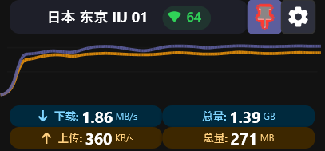
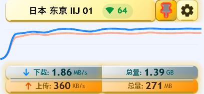
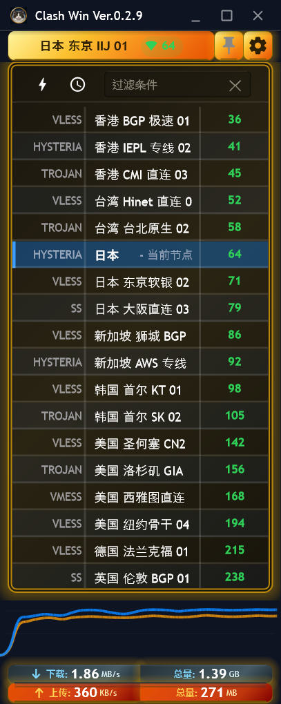
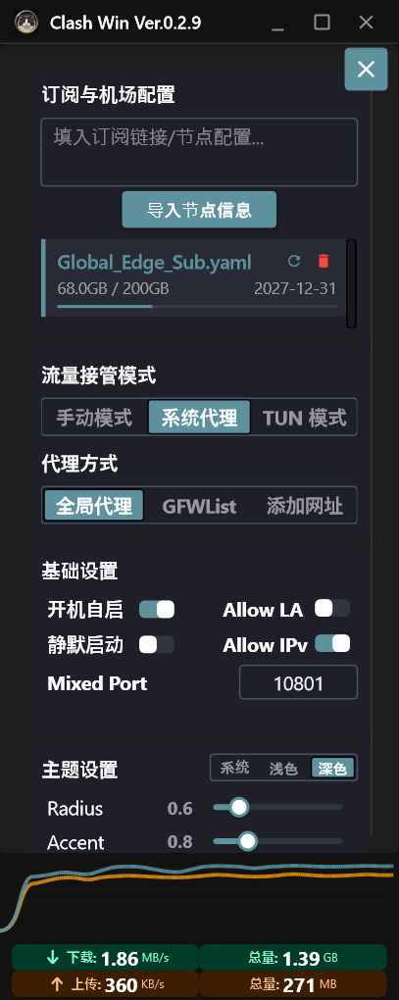
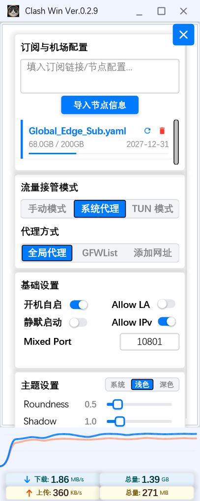
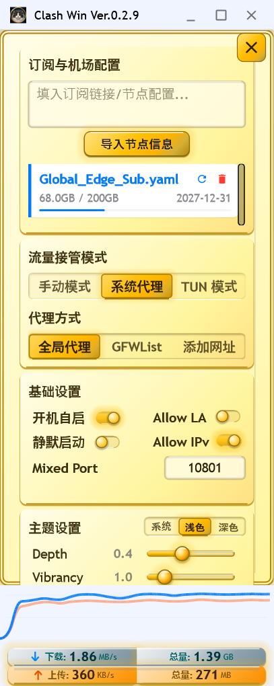
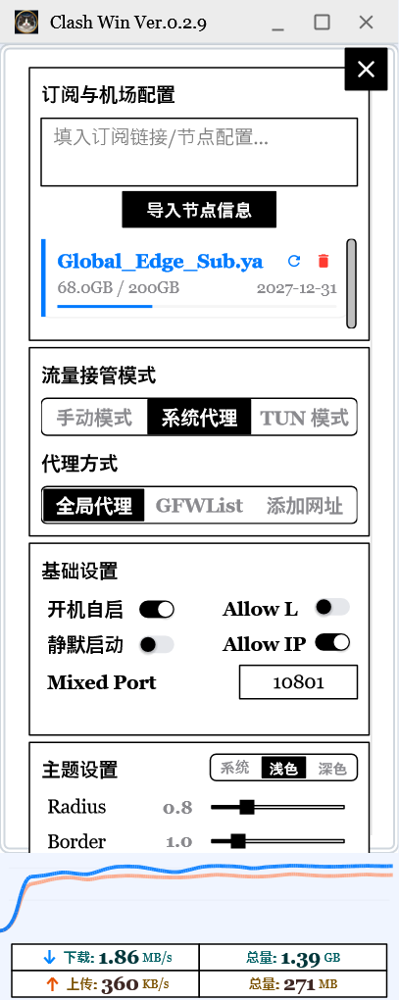
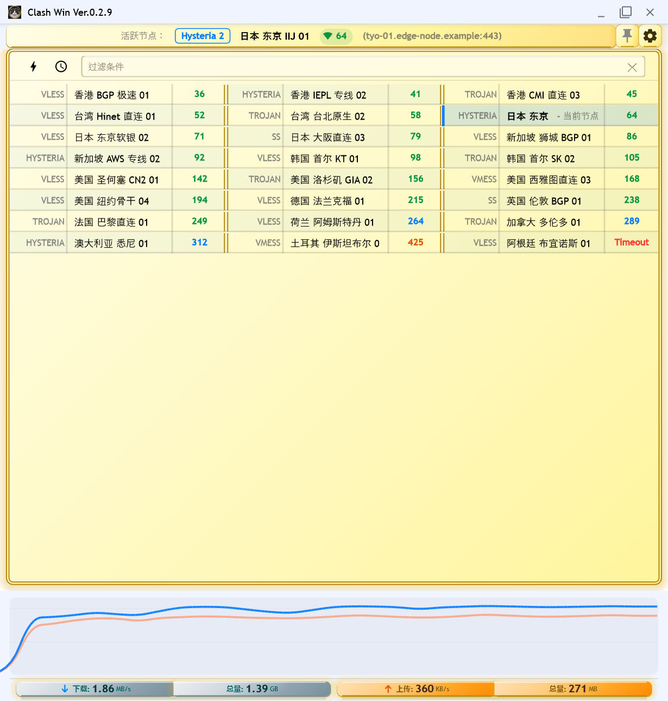
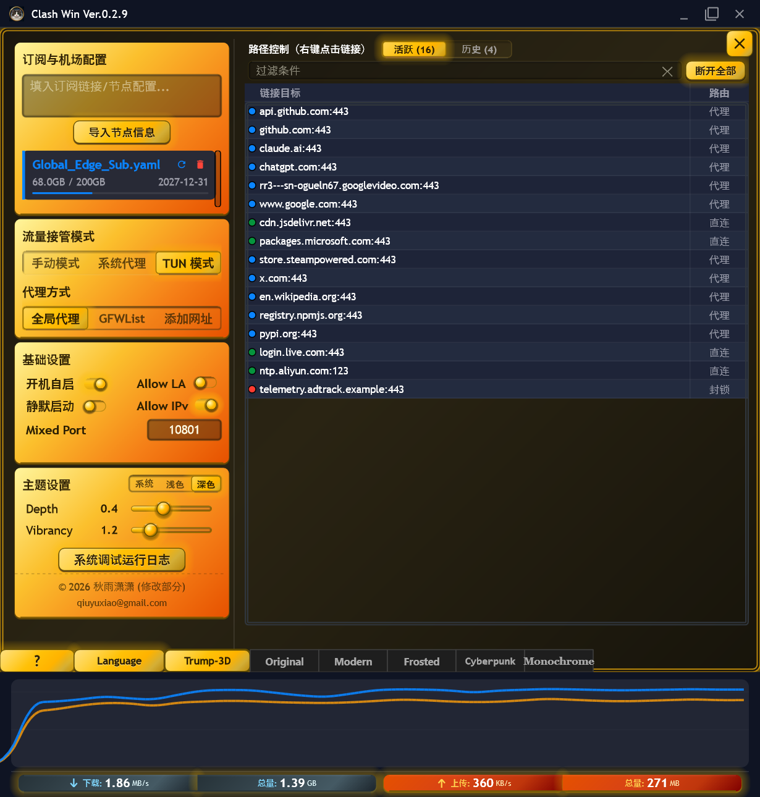

# Clash Win

[](https://github.com/qiu-yuxiao/clash-win/releases/latest)
[](https://github.com/qiu-yuxiao/clash-win/releases)
[](https://www.gnu.org/licenses/gpl-3.0)
[](https://isocpp.org)
[](https://github.com/qiu-yuxiao/clash-win)

> **Clash Win** — A pixel-level 1:1 Windows-native clone of **Clash Mini** (synced through **v3.2.5**), engineered 100% by AI with zero lines of manual code.
> Built with modern **C++20**, **Win32 API**, and **Direct2D / DirectWrite** — zero WebView2, zero Chromium, zero UI browser engine.

Clash Win preserves everything about Clash Mini — its minimalist zero-threshold workflow, 6 themes & 3D skeuomorphic visuals, smart filtered auto-switching, dual-frequency failover probe, and live path routing — differing only in programming language and name. It can coexist peacefully on disk alongside Clash Mini while enforcing clean runtime mutual exclusion so the two clients never conflict (see [Relationship with Clash Mini](#relationship-with-clash-mini-与-clash-mini-的关系) and [Known Limitations](docs/KNOWN_LIMITATIONS.md)).

---

## Quick Start Guide

> **Core Value**: Minimalist, zero-threshold, out-of-the-box — the preferred choice for beginners and native-performance enthusiasts alike.

### Getting Started
Click the **[Gear]** button in the upper-right corner of Clash Win, paste your subscription link or node configuration (supporting 19 protocols) into the *"Subscription Link / Node Config"* field, click **[Import Node Info]**, and wait for the proxy node to activate automatically.

### Client Configuration
* **Browsers**: Start browsing directly right after importing nodes (System Proxy is configured automatically).
* **Other Client Apps**: Most apps connect automatically. For apps requiring manual proxy settings, point them to `127.0.0.1` on Mixed Port `10801` (or dedicated SOCKS5 `10802` / HTTP `10803`).
* **Global Proxy**: For apps without manual proxy options, enable Clash Win's **TUN Mode**.

> [!NOTE]
> **What is [TUN Mode]?**
> It creates a system virtual network adapter to transparently route all system traffic. Suitable for region-locked games, CLI terminals, and software that ignores Windows system proxy settings.
> *Note: TUN mode consumes slightly more resources and requires the privileged Windows service (`clash_verge_service`). Unless you have these specific needs, the default System Proxy mode is sufficient.*

### Key Features
* **[Auto Switch & Fast Failover]**: Automatically speed-tests and switches to the fastest node upon importing or switching subscriptions, strictly respecting your active node filter subset to avoid undesired regions. A background 15–25s dual-frequency probe (`TCP:53` direct public IP + DNS fallback) detects congestion or dead nodes in real time and self-heals automatically.
* **[Rule Updates]**: Integrates popular rule sets and GeoIP / GeoSite databases, kept synced automatically.
* **[Mini-Monitoring & Zero-Render Standby]**: Shrink the window to its minimum size (`271×126`) to turn Clash Win into a compact desktop traffic monitor, or close to tray for true zero-render lightweight standby protected by offscreen sentinel windows and a `~1 MB` companion watchdog (`--guardian` with zero-drop core re-attach).
* **[6 Skins × Light/Dark & 13 Languages]**: Switch seamlessly among `Trump-3D (Retro-3D)`, `Original`, `Modern`, `Frosted`, `Cyberpunk`, and `Monochrome` skins with per-skin dual-factor sliders and 13 UI languages.
* **[Right-Click Routing (Advanced)]**: Expand or maximize the window to open **[Path Control]** alongside settings; right-click any live or historical connection to set highest-priority Direct, Proxy, or Reject rules on the fly.
* **[100% Native Architecture]**: Single native Win32/Direct2D client paired with upstream `mihomo` `v1.19.33` (`win-mihomo.exe`, with automatic missing-core recovery) and Ed25519 Minisign-verified in-app updates.

---

## 快速开始指南

> **核心价值**：极简、零门槛、开箱即用，与 Clash Mini 像素级一致的纯原生 Windows 体验。

### 开始使用
点击 Clash Win 右上角的 **[齿轮]** 按钮，将您的订阅链接或节点配置（支持 19 种主流协议）粘贴到「填入订阅链接/节点配置...」输入框中，点击 **[导入节点信息]**，等待代理节点自动激活即可。

### 客户端配置
* **浏览器**：导入节点后即可直接浏览网页（默认自动接管系统代理）。
* **其他客户端应用**：绝大多数应用可直接联网。少数需手动指定代理的软件，请填写地址 `127.0.0.1`、混合端口 `10801`（或专用 SOCKS5 端口 `10802` / HTTP 端口 `10803`）。
* **全局代理**：若软件不支持代理设置且无视系统代理，请开启 **TUN 模式**。

> [!NOTE]
> **什么是 [TUN 模式]？**
> 创建系统级虚拟网卡以接管全局流量，适用于锁区游戏、命令行终端等无视系统代理的程序。
> *注意：TUN 模式资源占用略高且需依赖系统服务（`clash_verge_service`）。无上述特殊需求时，保持默认的「系统代理」即可。*

### 核心功能
* **[自动切换与秒级自愈]**：导入或切换订阅后自动测速并切至最快节点；测速与自动切换严格遵循当前节点过滤子集，精准规避特定区域。内置 15～25 秒双频（`TCP:53` 直连公网 IP / DNS 兜底）健康度探针，实时避开拥堵或断流节点。
* **[规则自动同步]**：内置主流分流规则集与 GeoIP / GeoSite 数据库，后台静默同步更新。
* **[迷你监控与零渲染驻留]**：将窗口缩至最小尺寸（`271×126`）即可化身为桌面微型流量监控器；关闭窗口入托盘即进入真正零 D2D 渲染的极轻驻留态，并由屏幕外 1×1 防清理哨兵窗口与 `~1 MB` 伴生看门狗（`--guardian`，支持零断流无感重挂内核）双重守护。
* **[六套主题皮肤与 13 国语言]**：内置 `Trump-3D`（复古拟物）、`Original`、`Modern`、`Frosted`、`Cyberpunk`、`Monochrome` 六套主题皮肤，支持亮/暗/跟随系统切换、逐皮肤双因子实时滑块调节及 13 种界面语言热切换。
* **[右键快捷路由（高级用户）]**：拉宽或最大化窗口后，在右侧 **[路径控制]** 面板右键点击任意实时/历史连接域名，即可一键生成最高优先级的直连、代理或封锁规则。
* **[100% 纯原生与纯 AI 构建]**：全仓无一行人工手写代码，无 Chromium / WebView2 依赖（内置 QuickJS 仅用于离线执行订阅 `Script.js` 增强脚本）；搭载 `mihomo` `v1.19.33` 内核（`win-mihomo.exe`，缺失可自动下载校验恢复），支持基于 Minisign Ed25519 强验签的应用内自动更新。

---

## Visual Showcase / 界面预览

### 1. Micro-Monitoring Mode (桌面迷你流量监控模式)

| Standard Dark (`Original`) | Retro-3D Light (`Trump-3D`) |
| :---: | :---: |
|  |  |

### 2. Narrow Layout — Node List (窄窗口模式 · 节点列表)

<p align="left">
  
</p>

### 3. Multi-Skin Settings Panels (窄窗口模式 · 多皮肤设定面板)

| Dark Theme (`Original`) | Light Theme (`Modern`) |
| :---: | :---: |
|  |  |
| **Retro-3D Theme (`Trump-3D`)** | **Monochrome Theme (`Monochrome`)** |
|  |  |

### 4. Wide Window — 3-Column Node Wall & Expert Path Control (宽窗口三列节点墙与专家模式)

* **3-Column Node Card Wall — Light (`宽窗口三列节点卡片墙 · 浅色`)**:
  <br/>
  

* **Expert Settings + Live Path Control + Skin Bar — Dark (`宽窗口设置与实时路径控制 · 深色`)**:
  <br/>
  

---

## Download & Installation / 下载与安装

Download the latest release from the [Releases page](https://github.com/qiu-yuxiao/clash-win/releases). Every release provides two Windows x64 packages plus SHA256 checksums:

| Artifact / 产物 | Form / 形态 | Notes / 说明 |
| :--- | :--- | :--- |
| `ClashWin_<version>_x64-setup.exe` | NSIS Installer / 安装版 | Per-machine install (`Program Files`), **requires UAC**; registers or shares `clash_verge_service` / 安装时需管理员授权，自动配置或共用系统服务 |
| `ClashWin_<version>_x64_portable.zip` | Portable / 便携版 | Extract & run (`clashwin.exe`), `.config/PORTABLE` included, isolated data dir, no registry writes by default / 解压即用，配置独立存放于程序目录 |
| `SHA256SUMS.txt` | Checksums / 校验清单 | SHA256 hashes of both release artifacts / 安装包与便携包的 SHA256 校验值 |

```powershell
Get-FileHash .\ClashWin_<version>_x64-setup.exe -Algorithm SHA256
Get-FileHash .\ClashWin_<version>_x64_portable.zip -Algorithm SHA256
```

> [!WARNING]
> **Unsigned Windows Authenticode binary disclosure**: Release binaries do not carry a paid Windows Authenticode EV certificate, so Windows SmartScreen or UAC may display **"Unknown publisher"** on first launch — the same as Clash Mini releases. Always download from official [Releases](https://github.com/qiu-yuxiao/clash-win/releases) and verify against `SHA256SUMS.txt` (in-app updates additionally enforce Ed25519 Minisign signature verification). See [KNOWN_LIMITATIONS.md](docs/KNOWN_LIMITATIONS.md) and [SECURITY.md](SECURITY.md).

---

## System Requirements / 系统要求

| Item | Requirement |
| :--- | :--- |
| **OS** | **Windows 10 / Windows 11 (x64)** — pure Windows-native client |
| **Runtime** | Built-in Windows Direct2D 1.1 & DirectWrite only (**no WebView2, no .NET, no VC++ Redistributable required** — statically linked `/MT`) |
| **Privileges** | Standard user for System Proxy / Portable daily use; Administrator (UAC) required once when installing NSIS setup or enabling TUN service |
| **Disk** | ~55 MB installed (including `win-mihomo.exe` core and bundled GeoIP/GeoSite/ruleset assets) |
| **Network** | User-supplied subscription URL or proxy node config (the client ships zero built-in proxy servers) |

---

## Relationship with Clash Mini (与 Clash Mini 的关系)

**Clash Win is a 1:1 pixel-level native C++ clone of Clash Mini — able to coexist on the same PC, but never run simultaneously.**

| Dimension | Clash Mini | Clash Win |
| :--- | :--- | :--- |
| **UI & Host Stack** | Tauri 2 + Rust + React / MUI (WebView2) | **Pure C++20 + Win32 + Direct2D / DirectWrite** |
| **Browser Engine** | Chromium / Edge WebView2 | **None (0 MB Web Engine)** |
| **Code Authorship** | Reference baseline | **100% AI-generated, 0 lines of manual code** |
| **Feature & Pixel Parity** | Upstream truth source (synced through **v3.2.5**) | **1:1 behavior, layout, skins, locales & core pipeline** |
| **Data Directory** | `%APPDATA%\io.github.clash-mini.clash-mini` | `%APPDATA%\io.github.clash-win.clash-win` |
| **Version Track** | `3.x` | Independent `0.x` (`v0.1.0` → current `v0.2.9`) |

### Peaceful Coexistence & Runtime Mutual Exclusion ("Borrow & Return" / 借用与归还)
* **Safe Dual Installation**: Clash Win and Clash Mini store configurations, subscriptions, and logs in completely separate `%APPDATA%` directories. Neither installer nor uninstaller ever deletes the other's files, shortcuts, or autostart entries.
* **Automatic Runtime Mutual Exclusion**: Because both clients align 1:1 on proxy ports and share the `clash_verge_service` Windows service, **they cannot run at the same time**. Launching or installing Clash Win automatically and cleanly stops any running Clash Mini / `mini-mihomo` process and takes over `clash_verge_service` (and vice versa). If Clash Win is uninstalled while Clash Mini remains installed, the uninstaller automatically hands the `clash_verge_service` registration back to Clash Mini's binary path.

| Shared Runtime Resource | Clash Win | Clash Mini |
| :--- | :--- | :--- |
| Mixed / SOCKS5 / HTTP Ports | `10801` / `10802` / `10803` | `10801` / `10802` / `10803` |
| HTTP Guard Fallback Port | `7899` | `7899` |
| External Controller Port | `9098` (auto-increments if occupied) | `9098` (auto-increments if occupied) |
| Single-Instance / PAC Port | `33335` (Dev `33336`) | `33335` (Dev `33336`) |
| Named Pipe & Service | `\\.\pipe\mini-mihomo-win` · `clash_verge_service` | `\\.\pipe\mini-mihomo-win` · `clash_verge_service` |

---

## Tech Stack / 技术栈

| Layer | Technology | Role |
| :--- | :--- | :--- |
| **Language** | **ISO C++20 (`/MT`)** | Static-runtime native binary, zero external runtime DLL dependencies |
| **Graphics & UI** | **Direct2D + DirectWrite + WIC** | Hardware-accelerated custom widget tree, 6-skin theme engine, virtualized lists, offscreen pixel-tested rendering |
| **Windowing** | **Pure Win32 API** | Frameless DWM window, Per-Monitor v2 DPI scaling, independent layered `WS_EX_NOACTIVATE` tooltips, 1×1 sentinel windows |
| **Core & IPC** | **Named Pipe + WinHTTP + SCM** | HTTP/1.1 & WebSocket over `\\.\pipe\mini-mihomo-win` (with TCP controller fallback) + `clash_verge_service` privilege separation |
| **Profile Engine** | **yaml-cpp + nlohmann/json + QuickJS** | Full subscription merge/chain/field enhancement pipeline and sandboxed offline `Script.js` execution |
| **Security & Update** | **Ed25519 (Minisign) + BLAKE2b + SHA-256** | Cryptographically verified in-app client updates and core asset integrity checks |

---

## Building from Source / 从源码构建

### Prerequisites
* Windows 10 / 11 x64
* Visual Studio 2022 (or Build Tools) with **Desktop development with C++**
* CMake 3.20+ (bundled with VS 2022) and NSIS 3.x (optional, for building the setup installer)

```powershell
# 1. Install repository git hooks (one-time setup after clone)
powershell -NoProfile -ExecutionPolicy Bypass -File scripts\install_hooks.ps1

# 2. Place and verify the 5 upstream sidecar binaries in sidecar/
#    (See docs/05-sidecar-内核资产.md for exact versions & SHA256 baselines)
powershell -NoProfile -ExecutionPolicy Bypass -File scripts\verify_sidecar.ps1

# 3. Configure & build Release target
cmake -B build -G "Visual Studio 17 2022" -A x64
powershell -NoProfile -ExecutionPolicy Bypass -File scripts\build.ps1 -Configuration Release

# 4. Run isolated unit & offscreen pixel test suite
powershell -NoProfile -ExecutionPolicy Bypass -File scripts\run_tests.ps1
```

> [!NOTE]
> A fresh git clone compiles out of the box, but requires the 5 upstream `sidecar/*.exe` binaries (`win-mihomo.exe`, `clash-verge-service.exe`, install/uninstall helpers, and `sysproxy.exe`) in `sidecar/` before packaging or running locally. See [`docs/05-sidecar-内核资产.md`](docs/05-sidecar-内核资产.md) and [`KNOWN_LIMITATIONS.md`](docs/KNOWN_LIMITATIONS.md).

---

## Documentation & Links / 文档与导航

* **User Docs & FAQ**: [GitHub Wiki](https://github.com/qiu-yuxiao/clash-win/wiki) · [KNOWN_LIMITATIONS.md](docs/KNOWN_LIMITATIONS.md) · [SECURITY.md](SECURITY.md)
* **Engineering & Architecture**: [docs/README.md](docs/README.md) · [移植基本准则.md](移植基本准则.md) · [CHANGELOG.md](CHANGELOG.md)
* **Contributing & Release Runbook**: [CONTRIBUTING.md](CONTRIBUTING.md) · [docs/RELEASE_PROCESS.md](docs/RELEASE_PROCESS.md) (`scripts/release.ps1` mandatory single-entry release pipeline)
* **Feedback & Community**: [Releases](https://github.com/qiu-yuxiao/clash-win/releases) · [Issues](https://github.com/qiu-yuxiao/clash-win/issues) · [Discussions](https://github.com/qiu-yuxiao/clash-win/discussions)

---

## Copyright, Acknowledgements & Disclaimer

* **Lineage & Acknowledgements**:
  * **Clash Mini** — the 1:1 visual, behavioral, and architectural specification reference for this native C++ clone.
  * **[Clash Verge Rev](https://github.com/clash-verge-rev/clash-verge-rev)** — the upstream project from which Clash Mini derived.
  * **[Mihomo (MetaCubeX)](https://github.com/MetaCubeX/mihomo)** — the proxy core shipped as `win-mihomo.exe`.
  * Vendored open-source libraries under `third_party/` (`yaml-cpp`, `nlohmann/json`, `QuickJS-NG`), each governed by its own permissive license.
* **Copyright & License**: Custom portions Copyright (c) 2026 秋雨潇潇 (<qiuyuxiao@gmail.com>). Distributed under the **GNU General Public License v3.0 only ([GPL-3.0-only](LICENSE))**.
* **Disclaimer / 免责声明**:
  * Clash Win is a personal recreational AI-engineered native clone project, provided **"AS IS" without warranty of any kind**.
  * This software **does not provide any subscription links, proxy nodes, or server endpoints**. Users are solely responsible for the configurations they import and for complying with applicable local laws and network policies.
