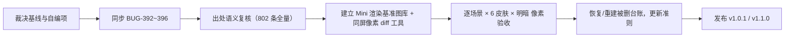

# Clash Win v1.0.0 审核报告（第一版）

- **审核人**：项目最终责任人（本会话）
- **审核日期**：2026-11-18
- **被审对象**：Clash Win `v1.0.0`（HEAD `1eaa845`，2026-11-17 07:23 发布）
- **事实源**：Clash Mini 工作区 `ClashVerge`（只读）。Win 自称对齐的版本是 **v3.5.0**（`c63244e2`），Mini 当前已到 **v3.5.3**（`a9efd4ba`）
- **审核宗旨**：1:1 完美克隆 Clash Mini，画面像素级对齐、功能完全相同（唯一允许的差异见《移植基本准则》§5）

---

## 一、结论

> [!CAUTION]
> **不通过。Clash Win v1.0.0 还没有达到「1:1 完美克隆」这个基本宗旨。** 下面三类问题都有实证：
> 1. **相对 Mini 现状，功能落后**：Win 发版约 6 小时后，Mini 就连发了 v3.5.1 / 3.5.2 / 3.5.3（BUG-392 至 396），Win 一条都没同步，其中有用户能直接看到的界面和行为变化。
> 2. **v3.5.0 基线本身也不干净**：有未登记的「Mini 没有、Win 自己加的」提示与界面（自编），违反准则「Mini 没有 → Win 不许有」。
> 3. **「像素级对齐」没有证据**：仓库里没有任何「Win 渲染 vs Mini 实际渲染」的对照基准。像素测试只检查 Win 和自己手写的期望值是否一致。出处门禁只检查行号存在，不检查语义，抽样约 1/4 的出处对不上。

下面这些项是好的（已实证）：Tauri 命令覆盖、语言文件结构、发版产物完整性、全量单测都过、出处门禁 PASS。所以项目**骨架完整、大体可用**，离「完美克隆」还有一段**可以量化的距离**。

---

## 二、审核方法与覆盖范围（如实说明）

| 手段 | 状态 |
| --- | --- |
| Mini 源码快照（v3.5.3 全量 + v3.5.0 精确归档）与 Win 源码静态对照 | ✅ 已做 |
| 13 语种 × 9 个 locale 文件逐 key 机器比对（11,297 个 key） | ✅ 已做 |
| Tauri 命令注册表（`lib.rs:124-168`，41 条）对 Win 逐条比对 | ✅ 已做 |
| Mini v3.5.0 → v3.5.3 增量（55 个文件）逐项核对 Win | ✅ 已做 |
| `src:` 出处随机抽样核验（按 v3.5.0 原文，抽 24 / 802 条） | ✅ 已做 |
| 发版产物哈希核验、全量单测日志、出处门禁 | ✅ 已做 |
| 5 路并行深度审计（外壳/设置/节点/后端/台账） | ❌ **三次启动都因服务端配额 / 网络中断失败**，没有产出 |
| 启动 Win GUI 与 Mini 同屏像素对照 | ❌ **没做**：本机 Clash Mini 正在运行、承载日常网络，Win 一启动就会按互斥方针强杀 Mini |

> [!IMPORTANT]
> 所以本报告是**「已发现问题」的下限，不是全部问题清单**。逐控件的像素与数值深度比对（外壳、设置抽屉、节点列表、后端阈值）还需要第二轮。

---

## 三、问题清单

### 3.1 P0：Mini v3.5.1 至 v3.5.3 增量全部没有同步

Win `src/`、`tests/` 中搜索 `BUG-392` 至 `BUG-396`：**零命中**。按行为逐项核对如下：

| BUG | Mini 变化（证据） | Win 现状 | 判定 |
| --- | --- | --- | --- |
| **392** | 过滤框：输入中文组词时不派发中间态；悬空算子（`-`、`!`、`日本 -`、`日本\|`）不提前触发测速（`base-search-box.tsx`、`proxy-head.tsx` 引入 `isIncompleteFilterInput` / `hasEffectiveFilterTerm`，`utils/node.ts`） | 组词状态有 `ime_composing_` 守卫（`main_window.cpp:3005-3010`），但**没有**悬空算子判定（`is_incomplete_filter` / `has_effective_filter` 零命中） | **部分缺失** |
| **393** | 防杀毒白名单文案：改为「添加安装目录，或 exe + 内核」（13 语种 `antivirus.how/brief`） | Win 已有新口径文案（换成 ClashWin 路径） | ✅ 已同步 |
| **394** | 守护任务独立运行时、窗口句柄原子化、12s 建窗超时回滚（`async_handler.rs`、`resolve/window.rs`、`window_manager.rs`、`server.rs`） | 大部分属于 Tauri/WebView 线程模型问题，原生实现不一定有对应缺陷；但**单实例客户端探测超时 1500ms**这类常量要核对 | **待核**（多半属形态差异，需逐条登记） |
| **395** | 新手引导瘦身：**删除了引导里的防杀毒卡片**（`first-run-guide-dialog.tsx` −74 行）；防杀毒弹窗重构为「方案一：一键开启静默启动 / 方案二：安全模式写 `whiteinternal.ini`」，含复制按钮（`antivirus-whitelist-dialog.tsx` +291 行；新 key `easyTitle`、`enableSilentBtn`、`rootSteps`、`copyPath`… 共 11 个）；静默启动改为全场景静默进托盘；托盘逻辑大改（`tray/mod.rs` +208） | Win 引导**仍画着**防杀毒卡片（`first_run_guide_dialog.cpp:755/762/895/1200`）；新弹窗结构与 11 个 key **全部缺失** | **缺失（用户可见）** |
| **396** | 前台手动切节点后，立即清理 `PROXY` 组里挂在旧节点上的存量连接（4 个前台入口）；连接详情新增「代理节点」行和「（旧节点连接）」标记（`path-control.ts`、`connection-detail.tsx`、`mihomo-api.ts`；新 key `proxyNode`、`staleNodeTag`） | 相关符号零命中，两个 key 缺失 | **缺失（用户可见 + 行为）** |

Locale 机器比对也印证了这一点：13 语种共 **169 个 key 缺失**、**53 处去掉品牌差异后仍不一致的文案**，全部来自上表的增量。

### 3.2 P0/P1：v3.5.0 基线内的「自编」项，未登记为刻意偏差

准则 §4 铁律三 / §六规定：「Mini 没有 → Win 不许有」；刻意偏差只允许 §5.4 清单里的 4 条。现状：

1. **11 处「用户特约补齐」的操作结果提示，Mini 都没有**。代码自注 `豁免: Mini 无对应物 — 用户特约补齐…（出处: 无）`：
   - [notice_handler.cpp:342-427](file:///c:/Users/sun_y/Documents/AntiGravity_Projects/ClashWin/src/ui/notice_handler.cpp#L336-L434)：节点切换成功、单节点测速结果/超时、批量测速择优、排序切换、窗口置顶、断开全部连接，共 7 处
   - [main_window.cpp:1335/1358/1385/1430](file:///c:/Users/sun_y/Documents/AntiGravity_Projects/ClashWin/src/ui/main_window.cpp#L1335)：断开单条、清空历史、皮肤切换、切换操作结果，共 4 处
   - 配套的 **30 个 Win 独有 locale key/语种**（`notices.windowPinned`、`skinSwitched`、`sortChanged`、`autoLaunchEnabled`、`themeSwitchedDark`、`quickRuleApplied`…），Mini 13 语种里都没有。
   - 来源提交 `239ab40`「全场景操作结果通知补齐 (T37/T38)」、`8a09102`。**《移植基本准则》§5.4 没有登记这一条**。
2. **日志查看器配色自加**：[utility_modals.cpp:1182](file:///c:/Users/sun_y/Documents/AntiGravity_Projects/ClashWin/src/ui/scenes/utility_modals.cpp#L1182) 自注「本查看器为 ClashWin 自加的终端风日志查看器，Mini 日志页无终端配色字面量」。

> [!WARNING]
> 如果这些确实是您当时口头要求的，需要补登到准则 §5.4 并写明依据；如果不是，就属于违规自编，应删除。**这一点需要您裁决**（见第五节）。

### 3.3 P1：「像素级对齐」缺少可证伪的证据链

1. **没有 Mini 渲染基准**：仓库里没有一张 Mini 实际渲染图作为对照基准。`t32` / `t37` 等「像素」测试都是 Win 离屏渲染和**手写期望值**比对，比如 hover 前后像素有没有变化、弹窗是否 ≤271px，**不和 Mini 比**。
2. **准则里的验证工具已被删除**：准则 §8.3 引用的 `scripts/shot_factor_effect.ps1`（12/12 组像素 diff），以及 `env_guard.ps1`、`run_tests_v4.ps1`、`run_tests_py.py`，**仓库中都不存在**。
3. **出处门禁只验「行号存在」，不验「内容对得上」**：`ui_src_gate.ps1` 报 `UNRESOLVED 0`。但按 v3.5.0 原文随机抽 24 条，**约 6 条明显错位**，示例：

   | Win 位置 | Win 声称 | Mini v3.5.0 该行实际内容 |
   | --- | --- | --- |
   | `node_list.h:39` | `proxy-groups.tsx:327 mb: 1 → 8` | `updateTestingGroups((prev) => …)` |
   | `node_list.cpp:643` | 搜索框 `py .3 / px .5 / fontSize 11`（`proxy-head.tsx:146`） | 清除防抖定时器的 `}` |
   | `node_list.cpp:1231` | `proxy-head.tsx:75 borderBottom 1px` | `// BUG-355: 响应 Ctrl+F…` 注释 |
   | `main_window.cpp:776` | 500ms 节流（`delay.ts:374`） | `if (proxy.alive === false)` |
   | `main_window.cpp:917` | 10s 超时（`profile-coordination.ts:184`） | `try {` |
   | `node_list.cpp:184` | `proxy-item.tsx:120 textTransform: 'uppercase'` | `'&:hover .the-icon': { display: 'none' }` |

   这说明「所有数值都能指到 Mini `file:line`」这条硬约束**实际上没有成立**。出处错位时，对应数值是否正确就无法确认，需要逐条复核。
4. **README 截图过期**：Win `docs/assets/screenshot_narrow_settings_light.png` 标题栏显示 **`Clash Win Ver.0.2.9`**，作为 v1.0.0 的门面不合格。

### 3.4 P2：治理与文档

- 《移植基本准则》§四、§十引用的 **9 份核心台账已被提交 `c81d4a8` 删除**：`docs/01/02/03/04/06`、`evidence/2026-11-07-agreements-full-audit.md`、`reverse-audit.md`、`skin-slider-semantics.md`、`2026-11-06-agreements-conflict.md`。「agreements 128 条全覆盖」「反向审计」这类结论**已经无法复查**。
- 准则 §8.3 写「Mini 没有 F1/F4 快捷键」，但 Mini v3.5.x 确实有（`utils/disable-webview-shortcuts.ts:47/56`）。Win 已按 Mini 实现（这一点是对的），准则条文**过时没改**。
- Win `assets/locales/*/layout.json` 里同时有 `switchedToGfwlist` 和 `switchedToGfwList` 两个仅大小写不同的重复 key（PowerShell 的 `ConvertFrom-Json` 直接报错），属于残留。
- 安装包和便携包**没有代码签名**（`SIGNATURE_STATUS.txt = NotSigned`），已在 KNOWN_LIMITATIONS 登记，不算 1:1 偏差。

---

## 四、已核实达标的项

| 项 | 证据 |
| --- | --- |
| Tauri 命令覆盖 | Mini `lib.rs:125-167` 共 41 条，Win 按名全部覆盖；只有 `begin/step/end_window_resize` 三条没有，Win 用原生 `WM_ENTERSIZEMOVE` / `WM_SIZING` 实现，属合法形态差异 |
| Locale 结构 | 13 语种齐全；v3.5.0 范围内去掉品牌差异后文案零差异（差异都来自 3.5.1+ 增量） |
| F1/F4 快捷键（BUG-389） | Mini 确有，Win 已实现 |
| 品牌替换 | `Clash Mini` → `Clash Win`、`mini-mihomo.exe` → `win-mihomo.exe`、安装路径替换一致 |
| 全量单测 | `build/cwtest_logs/tests_full.log`：**741 cases, 0 failed, 0 assertion failures**（`UT_TEST` 计数 741，和日志一致） |
| 出处门禁 | `ui_src_gate.ps1` 通过，`UNRESOLVED 0`（只代表行号存在，见 3.3-3） |
| 发版产物 | `dist/` 下安装包、便携包、`app-update.json` 的 SHA256 与 `SHA256SUMS.txt` 一致，已保留在本地 |

---

## 五、需要您裁决的事项

1. **对齐基线**：v1.0.0 的验收按 Mini **v3.5.0**（Win 发版时的锚点）算，还是按 Mini **当前 v3.5.3** 算？这决定 3.1 节是「基线缺陷」还是「下一版增量」。
2. **11 处「用户特约」提示 + 终端风日志配色**：是您当时要求的吗？
   - 是 → 我把它们补登进准则 §5.4（第五、六条刻意偏差）；
   - 否 → 按「Mini 没有 → Win 不许有」删除。
3. **像素级验收方式**：真正的同屏像素对照必须让 Win 运行，而 Win 一启动就会强杀 Mini。可选做法：
   - 选一个您不需要上网的时间窗口，由我按「先截 Mini 基准图 → 退出 Mini → 跑 Win 截图 → 恢复 Mini」流程执行；
   - 或者在另一台机器 / 虚拟机上做。

---

## 六、建议的整改路线（待您确认后执行）

1. 按裁决结果处理 3.2 节的自编项。
2. 同步 BUG-392 / 395 / 396（用户可见），逐条核对 BUG-394 并登记形态差异。
3. 给 `ui_src_gate.ps1` 加语义校验：数值字面量必须出现在被引行 ±N 行内。对 802 条出处做全量复核，修正错位的出处，以及因此算错的数值。
4. 建立 Mini 渲染基准（可按 Mini 截图方式：271×680 和 640×860 两档 × 6 皮肤 × 明/暗 × 主要场景），配一个同屏像素 diff 脚本，把「像素级对齐」变成可证伪的验收项。
5. 重建 agreements 覆盖台账和反向审计台账（这次按 v3.5.3 / 当前基线），修订准则里的过时条文。
6. 第二轮深度审计：外壳、设置抽屉、节点列表、后端阈值逐项数值比对，补全本报告第二节标注的空白。

---

*附：审核过程数据（locale 差异全表、出处抽样脚本、Mini 快照）存放在本会话 `scratch/` 目录。Mini 快照已排除 `github_token.txt`、`tauri-key` 等机密文件。*
