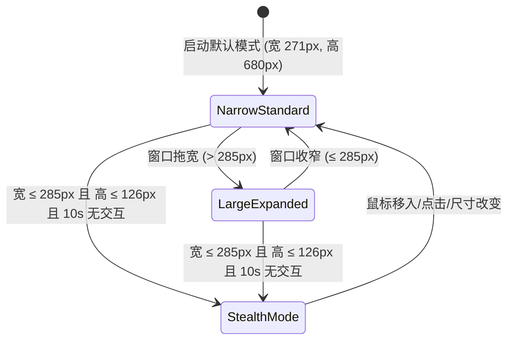

# ClashWin C++20 原生技术架构设计说明书 (Architecture Design Document)

> **归档位置**：`docs/07_cpp20_architecture_design.md`  
> **关联清单项**：Phase 2 C++20 / Win32 / Direct2D 架构映射与技术设计  
> **技术基石**：ISO C++20, Windows SDK (Win32), Direct2D 1.1, DirectWrite, Direct3D 11, WinHTTP, WinSock2

---

## 1. 整体架构分层与线程模型 (Architecture & Threading Model)

```
┌────────────────────────────────────────────────────────────────────────┐
│                        ClashWin 纯原生客户端                           │
├────────────────────────────────────────────────────────────────────────┤
│ [Win32 消息泵与 UI 线程 (Main Thread / Apartment Thread)]              │
│  - GetMessage / TranslateMessage / DispatchMessage 消息循环            │
│  - WndProc (WM_NCCALCSIZE, WM_NCHITTEST, WM_SIZING, WM_PAINT)          │
│  - D2DRenderContext (ID2D1HwndRenderTarget, IDWriteFactory, 帧呈现)    │
│  - UI Component Tree (WindowRoot -> NavigationBar -> NodeList ...)     │
│  - 6 套拟物皮肤着色与物理参数滑块 (Retro3D, Cyberpunk, etc.)           │
├────────────────────────────────────────────────────────────────────────┤
│ [状态分发与事件总线 (State & Event Bus)]                                │
│  - AppState (全局权威持久化状态 verge.yaml / profiles.yaml)            │
│  - StateNotifier (观察者模式 / 局部重绘脏区标记 InvalidateRect)        │
│  - UI Action Dispatcher (用户交互事件 -> 异步任务投递)                 │
├────────────────────────────────────────────────────────────────────────┤
│ [后台异步工作线程池 (Worker Thread Pool / std::jthread)]               │
│  - LatencyProbeService: 15s 恒定周期 / 3s 重试加速 / 2 击自愈探针      │
│  - CoreSupervisor: Windows Job Object 绑定 mini-mihomo 进程生命周期   │
│  - NamedPipeClient: \\.\pipe\mini-mihomo 24 次退避重试管道通信         │
│  - MihomoRestClient: WinHTTP 异步 API 客户端 (127.0.0.1:9098)          │
│  - ProfileSyncService: 订阅拉取 (WinHTTP) + Universal Parser 格式转换 │
│  - SingleInstanceServer: WinSock2 本地 Socket 33335 监听与实例唤醒     │
│  - SystemProxyService: Win32 注册表 IE 代理接管与广播                  │
│  - ServiceManager: Win32 SCM API (clash_verge_service) 交互            │
└────────────────────────────────────────────────────────────────────────┘
```

### 1.1 线程安全与跨线程通信准则
1. **主线程专职 GUI 与 Win32 消息**：
   - 所有 Direct2D 绘制、DirectWrite 文本排版、窗口属性调整、托盘菜单弹出均严格在主 UI 线程执行。
   - 严禁在主 UI 线程进行阻塞式网络 I/O、文件读写或长时间休眠（`Sleep`）。
2. **工作线程（Worker Threads）全异步隔离**：
   - 网络请求（WinHTTP）、管道 I/O（Named Pipe）、进程管理（CreateProcess / WaitForSingleObject）、文件落盘（Save Config）全部运行在 `std::jthread` 或线程池中。
   - **向主线程回传数据**：使用自定义 Win32 消息（`WM_APP + x`）或带线程安全队列的 `PostMessageW(hWnd, WM_APP_DISPATCH, ...)`，确保 UI 状态更新在主线程安全调度。

---

## 2. Direct2D / DirectWrite 渲染管线与 3D 拟物排版抽象

### 2.1 渲染基础设施
- **渲染目标**：`ID2D1HwndRenderTarget`，使用硬件加速（`D2D1_RENDER_TARGET_TYPE_DEFAULT`），双缓冲呈现。
- **字体与文本引擎**：`IDWriteFactory`，创建文本格式（`IDWriteTextFormat`）并使用 `SimSun`, `Trebuchet MS`, `Consolas` 等对齐字体族。
- **DPI 自动感知**：调用 `SetProcessDpiAwarenessContext(DPI_AWARENESS_CONTEXT_PER_MONITOR_AWARE_V2)`，响应 `WM_DPICHANGED`，动态重构 Direct2D 尺寸与字体缩放矩阵。

### 2.2 轻量组件树模型 (UI Component Tree)
摒弃繁重的第三方 GUI 库，采用极简高性能的组件树抽象：
```cpp
class UIElement {
public:
    virtual ~UIElement() = default;
    virtual void SetBounds(const D2D1_RECT_F& bounds) { bounds_ = bounds; }
    [[nodiscard]] const D2D1_RECT_F& GetBounds() const { return bounds_; }

    virtual void OnRender(ID2D1RenderTarget* pRT, const RenderTheme& theme) = 0;
    virtual bool OnHitTest(float x, float y) const;
    virtual bool OnMouseDown(float x, float y, MouseButton btn) { return false; }
    virtual bool OnMouseUp(float x, float y, MouseButton btn) { return false; }
    virtual bool OnMouseMove(float x, float y) { return false; }

protected:
    D2D1_RECT_F bounds_{};
    bool is_hovered_{false};
    bool is_pressed_{false};
};
```

### 2.3 3D 实体拟物渲染器 (Skeuomorphic Renderer)
实现原版 6 套主题的物理质感着色器与画刷管线：
1. **顶底双色线性渐变（Linear Gradient Brush）**：模拟顶部高光反射与底部阴暗面。
2. **1px 物理高光与倒角凹槽阴影**：
   - 凸起实体（Button / Card）：上侧/左侧绘制 `HighlightColor`（白色半透明 0.3~0.8），下侧/右侧绘制 `ShadowColor`（黑色半透明 0.4~0.7）。
   - 凹陷实体（Input / Selected Item）：上侧内阴影，下侧微光边缘。
3. **按下物理偏移（Press Offset）**：当 `is_pressed_ == true` 时，内容区域整体向右下平移 `(1.0f * depthFactor, 1.0f * depthFactor)` 像素，阴影收缩，创造真实物理按键行程反馈。
4. **双参数滑块引擎**：
   - 滑块 1 与滑块 2 实时驱动 `depthFactor` 与 `vibrancyFactor`，动态微调阴影厚度与颜色饱和度。

---

## 3. 响应式布局与视口状态机

### 3.1 视口模式状态机

- **窄窗极简形态（$\le 285px$）**：
  - 内容区：顶部导航条（高度 40px）、当前节点卡片（高度 32px）、小流量面板（高度 24px）、主节点单列列表（行高 20px）。
  - 右侧连接监控大表彻底卸载，不订阅、不查询、不绘制。
- **大窗全功能形态（$> 285px$）**：
  - 展开为双栏布局：左栏为控制与节点列表，右栏挂载连接监控虚拟列表（`ConnectionTable`）。
- **极窄隐匿模式（Stealth Mode）**：
  - 高度 $\le 126px$ 且宽度 $\le 285px$ 时，10 秒空闲隐藏标题栏与操作条，仅展示节点状态与延迟。

---

## 4. 核心管理与系统级集成服务

### 4.1 内核子进程生命周期守护器（`CoreSupervisor`）
```cpp
class CoreSupervisor {
public:
    static CoreSupervisor& Instance();
    bool StartCore(const std::filesystem::path& core_path, const std::filesystem::path& config_path);
    void StopCore();
    void RestartCore();

private:
    HANDLE h_job_object_{NULL};
    HANDLE h_process_{NULL};
    HANDLE h_thread_{NULL};
    DWORD process_id_{0};
    void SetupJobObject();
};
```
- **Windows Job Object 铁律**：`SetInformationJobObject` 配置 `JobObjectExtendedLimitInformation` 并置位 `JOB_OBJECT_LIMIT_KILL_ON_JOB_CLOSE`。
- **环境抑制**：通过 `CreateProcessW` 的 `lpEnvironment` 传入：
  `GOMEMLIMIT=96MiB\0GOGC=50\0GOMAXPROCS=2\0`

### 4.2 命名管道通信客户端（`NamedPipeClient`）
- 路径：`\\.\pipe\mini-mihomo`
- 24 次指数退避重试逻辑：
```cpp
HANDLE OpenPipeWithRetry(LPCWSTR pipe_name) {
    for (int retry = 0; retry < 24; ++retry) {
        HANDLE hPipe = CreateFileW(pipe_name, GENERIC_READ | GENERIC_WRITE, 0, NULL, OPEN_EXISTING, 0, NULL);
        if (hPipe != INVALID_HANDLE_VALUE) return hPipe;
        if (GetLastError() != ERROR_PIPE_BUSY) return INVALID_HANDLE_VALUE;
        WaitNamedPipeW(pipe_name, 125);
    }
    return INVALID_HANDLE_VALUE;
}
```

### 4.3 Windows 注册表 IE 代理管理器（`SystemProxyManager`）
- 操作目标：`HKCU\Software\Microsoft\Windows\CurrentVersion\Internet Settings`
- 方法契约：
  - `SetProxy(const std::wstring& server, const std::wstring& bypass)`
  - `ClearProxy()`
  - `NotifySettingsChanged()` 调用 `InternetSetOptionW`

### 4.4 Windows 服务管理器客户端（`ServiceManager`）
- 操作目标服务：`clash_verge_service`
- 使用 Win32 `OpenSCManagerW`、`OpenServiceW`、`QueryServiceStatusEx`、`StartServiceW` 交互。
- 提权检测：通过 `GetTokenInformation(TokenElevation)` 校验；若非管理员则调用 `ShellExecuteExW` 带 `L"runas"` 触发安装器。

---

## 5. 项目工程结构与源码目录规划

```
c:\Users\sun_y\Documents\AntiGravity_Projects\ClashWin\
├── CMakeLists.txt                    # 顶层 CMake 构建配置 (MSVC / C++20 / Direct2D)
├── README.md                         # 权威基准说明书
├── PORTING_PROCESS_CHECKLIST.md      # 5 阶段移植执行检查清单
├── docs/                             # 阶段一与阶段二全量技术分析与规范报告
│   ├── 01_first_run_pipeline_analysis.md
│   ├── 02_core_ipc_pipeline_analysis.md
│   ├── 03_proxy_selection_pipeline_analysis.md
│   ├── 04_system_integration_pipeline_analysis.md
│   ├── 05_window_tray_lifecycle_analysis.md
│   ├── 06_codebase_data_contract_mapping.md
│   ├── 07_cpp20_architecture_design.md
│   └── CLASH_MINI_AUTHORITATIVE_SPEC.md
├── include/                          # C++20 公共头文件
│   └── clashwin/
│       ├── common/
│       │   ├── types.h               # 通用枚举与几何结构 (Rect, Point, Theme)
│       │   ├── constants.h           # 几何与网络常量 (271, 126, 640, 860, 33335)
│       │   └── logger.h              # 高性能异步日志器
│       ├── core/
│       │   ├── core_supervisor.h     # Job Object 与 mini-mihomo 进程管理
│       │   ├── named_pipe.h          # 命名管道客户端
│       │   └── mihomo_api.h          # WinHTTP REST API 客户端 (127.0.0.1:9098)
│       ├── config/
│       │   ├── verge_config.h        # verge.yaml 数据结构与持久化
│       │   ├── profile_config.h      # profiles.yaml 与订阅项数据结构
│       │   └── universal_parser.h    # Base64/YAML/URI-List 协议解析器
│       ├── system/
│       │   ├── sysproxy.h            # 注册表代理设置
│       │   ├── service_client.h      # clash_verge_service SCM 交互
│       │   └── singleton.h           # WinSock2 33335 端口抢占与唤醒
│       ├── ui/
│       │   ├── window.h              # Win32 主窗口过程 (WM_SIZING, WM_NCHITTEST)
│       │   ├── d2d_renderer.h        # Direct2D / DirectWrite 渲染器
│       │   ├── tray_icon.h           # 静态极简系统托盘
│       │   ├── theme.h               # 6 套拟物主题与物理光影定义
│       │   └── components/           # UI 组件树 (NodeList, Sliders, Cards)
│       └── app.h                     # ClashWin 应用程序顶层主入口控制器
└── src/                              # C++20 实现代码
    ├── main.cpp                      # WinMain 入口与单实例前置检查
    ├── app.cpp                       # App 生命周期编排
    ├── core/                         # 内核守护与通信实现
    ├── config/                       # 配置与通用解析器实现
    ├── system/                       # 系统注册表与服务交互实现
    └── ui/                           # Win32 窗口过程、D2D 渲染与组件实现
```
