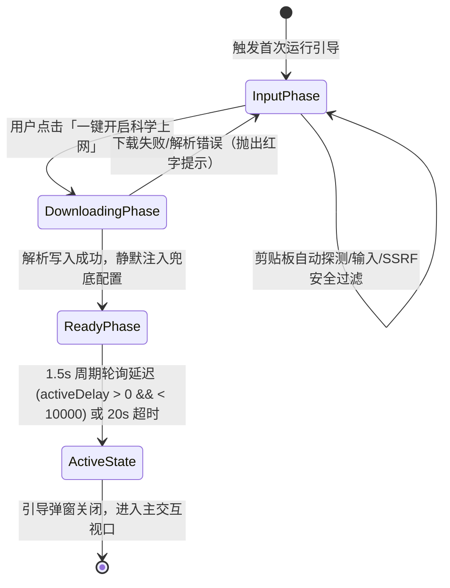

# Clash Mini 1:1 精准移植权威功能与行为对齐规范说明书 (Authoritative Porting Specification)

> **文档性质**：ClashWin 项目全链路实施最高权威技术规范  
> **归档位置**：`docs/CLASH_MINI_AUTHORITATIVE_SPEC.md`  
> **目标工程**：`ClashWin` (C++20 / Win32 / Direct2D / WinHTTP)  
> **逆向源工程**：`ClashVerge` (Clash Mini 原生逻辑，严格只读)

---

## 目录
1. [总架构原则与技术栈定义](#1-总架构原则与技术栈定义)
2. [首次运行与订阅配置流（First-Run Pipeline）](#2-首次运行与订阅配置流first-run-pipeline)
3. [内核管理、IPC 通信与恢复机制（Core & IPC）](#3-内核管理ipc-通信与恢复机制core--ipc)
4. [代理管控、健康监测与自愈体系（Proxy & Health Probe）](#4-代理管控健康监测与自愈体系proxy--health-probe)
5. [流量接管、系统代理与 TUN 服务（System Integration）](#5-流量接管系统代理与-tun-服务system-integration)
6. [窗口几何、消息钩子与常驻托盘（Window & Tray Lifecycle）](#6-窗口几何消息钩子与常驻托盘window--tray-lifecycle)
7. [6 套 3D 拟物特色皮肤与 UI 交互系统（UI/UX & Themes）](#7-6-套-3d-拟物特色皮肤与-ui-交互系统uiux--themes)
8. [持久化配置文件 Schema 对齐表（Data Schemas）](#8-持久化配置文件-schema-对齐表data-schemas)

---

## 1. 总架构原则与技术栈定义

### 1.1 纯原生无运行时原则
- **全面摒弃 Web 技术栈**：坚决不使用任何 WebView2、Chromium Embedded Framework (CEF)、Node.js 或跨平台框架（Electron / Tauri）。
- **语言标准**：现代 C++20（使用概念 `concepts`、协程 `coroutines`、`std::jthread`、`std::string_view`）。
- **GUI 渲染栈**：纯 Win32 消息循环 + Direct2D / DirectWrite 硬件加速 Direct3D11 表面渲染，彻底杜绝 GDI 闪烁，达成 60~120fps 丝滑流畅交互。
- **系统网络与 IPC**：
  - 订阅拉取与 REST API：Windows 原生 WinHTTP 异步接口。
  - 单实例检测与外部唤醒：WinSock2 本地 Socket 监听 `127.0.0.1:33335`。
  - 内核通信：Win32 命名管道 `\\.\pipe\mini-mihomo` + REST API `127.0.0.1:9098`。
- **内存与性能指标**：常驻运行总内存（主客户端 + 内核子进程）控制在 **30MB ~ 60MB**，UI 隐藏时 CPU 占用恒为 **0.0%**。

---

## 2. 首次运行与订阅配置流（First-Run Pipeline）

### 2.1 首次启动识别判定式
- **铁律**：`items.length === 0` **不是**首次启动判定依据（因为初始化时会自动注入 `Merge` 和 `Script` 两个内置配置）。
- **权威判定式**：
  $$\text{IsFirstRun} \iff (\text{RealProfileCount} == 0) \land (\text{FirstRunCompletedFlag} == \text{false})$$
  其中 `RealProfileCount` 仅统计 `type == "remote" || type == "local"` 的订阅项；`FirstRunCompletedFlag` 存储于应用配置 `verge.yaml` 的 `first_run_completed`。

### 2.2 引导交互状态机（2 阶段）

1. **输入阶段（`input`）**：
   - 自动读取剪贴板，若匹配 `http://`、`https://` 或通用协议（`vmess://`, `ss://`, `trojan://`, `hysteria2://`）则自动预填。
   - **SSRF 防御**：严格拦截私有局域网 IP（`127.*`, `10.*`, `172.16-31.*`, `192.168.*`, `169.254.*`, `localhost`）。
2. **就绪就绪阶段（`ready`）**：
   - 写入 `profiles.yaml` 并激活当前配置，启动/重载内核。
   - 启动 **1.5 秒固定节拍定时器**，轮询内核 REST API `GET /proxies/PROXY`，当 `activeDelay > 0 && activeDelay < 10000` 时立即置绿打勾；**20 秒兜底超时**。

### 2.3 Universal Parser 三级解析降级机制
1. **Tier 1 - 原生 YAML**：尝试以 YAML 解析，检查是否存在 `proxies` 顶级列表。
2. **Tier 2 - Base64 解码**：若为纯密文字符串，执行 Base64 解码（支持 URL-Safe 变种与末尾 `=` 自动补齐）。
3. **Tier 3 - URI-List 逐行解析器**：
   - 支持 `vmess://`、`ss://`、`trojan://`、`hysteria2://`、`hysteria://`、`wireguard://`。
   - **分词铁律（Query Before Userinfo）**：必须先按第一个 `?` 切割参数区，再在前半段按最后一个 `@` 切割密码/密钥与主机端口，防止 query 内部携带 `@` 导致截断解析错位。

---

## 3. 内核管理、IPC 通信与恢复机制（Core & IPC）

### 3.1 Go 运行时内存抑制与进程树强绑定
- **启动环境变量**：
  - `GOMEMLIMIT=96MiB`（严控 Go 堆内存，超限前触发 GC）
  - `GOGC=50`（积极回收无用内存）
  - `GOMAXPROCS=2`（双核限制，避免多核协程上下文调度虚耗）
- **Windows Job Object 进程树铁律**：
  - 创建独立 Win32 作业对象，配置 `JOB_OBJECT_LIMIT_KILL_ON_JOB_CLOSE`。
  - 将启动的 `mini-mihomo.exe` 子进程句柄加入该 Job Object。
  - 无论主程序是正常退出、任务管理器强制杀进程还是异常崩溃，Windows 内核自动级联强杀内核子进程，**绝对零孤儿进程残留**。

### 3.2 命名管道通信与 24 次退避重试
- **管道路径**：`\\.\pipe\mini-mihomo`
- **重试策略**：遇到 `ERROR_PIPE_BUSY` 时，执行最多 24 次退避重试（单次间隔 125ms，总等待预算 3000ms），随后调用 `WaitNamedPipeW`。

### 3.3 内核重启状态快照与恢复（Snapshot & Restore）
- **快照保存**：重启前调用 `GET /proxies/PROXY`，提取 `selected_node = data["now"]`。
- **重启后恢复**：
  - 阶段 1：轮询 REST API 连通性（每 100ms 一次，上限 30s）。
  - 阶段 2：等待 `PROXY` 组填充（轮询 `/proxies/PROXY`，上限 20s）。
  - 阶段 3：若 `selected_node` 仍在可用列表中，发送 `PUT /proxies/PROXY {"name": selected_node}`。
  - 阶段 4：若不在，降级发送当前过滤列表的首个有效节点。

---

## 4. 代理管控、健康监测与自愈体系（Proxy & Health Probe）

### 4.1 双核心组架构模型（Dual-Core Groups）
- **`PROXY` 组**：`type: select`，面向用户交互，受 UI 选点直接控制。
- **`PROXY__METRICS` 组**：`type: url-test`，`interval: 300`，`url: http://www.gstatic.com/generate_204`，由内核内部独立探测各节点延迟，**杜绝在 TUN 模式下因自身选点探测形成自回环死锁**。

### 4.2 广告/废弃节点清洗过滤（Dummy Node Filter）
- **过滤规则 1（英文与网址）**：包含 `traffic`, `expire`, `renew`, `reset`, `left`, `http://`, `https://`, `sub.`, `t.me/` 等（不区分大小写）。
- **过滤规则 2（中文广告字样严格前缀匹配）**：
  - 中文字样：`剩余流量`, `过期时间`, `重置时间`, `购买订阅`, `套餐到期`, `官网`, `发布页`, `通知`, `公告`, `更新`。
  - **严禁全词模糊 `contains`**（防止误杀 `"HK-流量优化"` 等正常节点名），必须使用去除空格后的**严格前缀等于或起始于**（`starts_with`）。
- **过滤规则 3（合法服务器地址）**：排除 `server == "127.0.0.1"`、`server == "1"` 等占位符虚拟节点。

### 4.3 恒定 15 秒健康探针与 2 击自愈（Health Probe & Auto-Heal）
- **恒定周期**：常驻后台探针周期严格恒定为 **15 秒**（窗口关闭或最小化时不降频）。
- **重试加速**：当前活跃节点延迟探测超时或返回异常时，探测周期立即动态收紧为 **3 秒**。
- **防抖自愈**：连续 **2 次失败**才正式触发全节点测速与最优顺位自动切换，彻底过滤网络瞬时毛刺。

---

## 5. 流量接管、系统代理与 TUN 服务（System Integration）

### 5.1 Windows 注册表系统代理接管
- **操作项**：`HKCU\Software\Microsoft\Windows\CurrentVersion\Internet Settings`
  - `ProxyEnable` = `1` (启用) / `0` (关闭)
  - `ProxyServer` = `"127.0.0.1:10801"`
  - `ProxyOverride` = `"localhost;127.*;10.*;172.16.*;172.17.*;172.18.*;172.19.*;172.20.*;172.21.*;172.22.*;172.23.*;172.24.*;172.25.*;172.26.*;172.27.*;172.28.*;172.29.*;172.30.*;172.31.*;192.168.*;<local>"`
- **互斥防护**：启用全局代理前必须先清空 `AutoConfigURL`（PAC）；启用 PAC 前必须清空 `ProxyServer`。
- **系统通知**：调用 `InternetSetOptionW(NULL, INTERNET_OPTION_SETTINGS_CHANGED, ...)` 与 `INTERNET_OPTION_REFRESH` 全局广播。

### 5.2 TUN 模式与 IPv6 顶层防泄漏铁律
- **配置注入规范**：
  ```yaml
  tun:
    enable: true
    stack: gvisor
    dns-hijack:
      - "tcp://any:53"
      - "udp://any:53"
    auto-route: true
    auto-detect-interface: true
  dns:
    enable: true
    enhanced-mode: fake-ip
    fake-ip-range: 198.18.0.1/16
    fake-ip-range6: 2001:2::0/64
    fallback-filter:
      geoip: true
      geoip-code: CN
  ipv6: true  # 必须恒为 true！哪怕用户关闭了 dns.ipv6，顶层也必须为 true 以接管系统 IPv6 路由防止直连旁路泄露
  ```

### 5.3 TUN 服务（`clash_verge_service`）协同
- **隔离门控**：仅在激活 TUN 模式且当前进程处于普通非提权（Non-Elevated）权限时，才唤起 Windows 服务接管；系统代理模式下绝对不调用系统服务。
- **优雅降级**：若系统服务未安装且用户未授权 UAC，系统自动弹出通知并优雅降级为系统代理模式。

---

## 6. 窗口几何、消息钩子与常驻托盘（Window & Tray Lifecycle）

### 6.1 窗口几何极限与自绘原则
- **尺寸定义**：
  - 默认尺寸：`271px × 680px`
  - 极限最小尺寸：`271px × 126px`（`MINIMAL_WIDTH × MINIMAL_HEIGHT`）
  - 最大允许尺寸：`640px × 860px`
  - 窄窗响应式断点：`285px`（$\le 285px$ 时单列布局并卸载监控大表）
- **口径唯一化**：所有尺寸统一使用客户区内尺寸（Inner Size），所有位置统一使用屏幕绝对外位置（Outer Position）。关闭无框阴影（`shadow(false)`），杜绝 `WM_NCCALCSIZE` 带来的物理内缩误差。

### 6.2 Win32 `WM_SIZING` 锁死防下移钩子
针对 Windows 在上边缘拖拽缩放至最小高度时持续增加 Y 坐标导致窗口向下飘移的 Bug，原生 WndProc 必须拦截：
```cpp
if (msg == WM_SIZING) {
    RECT* rc = reinterpret_cast<RECT*>(lParam);
    UINT side = static_cast<UINT>(wParam);
    UINT dpi = GetDpiForWindow(hWnd);
    double scale = static_cast<double>(dpi) / 96.0;
    int min_h = static_cast<int>(std::round(126.0 * scale));
    if (side == WMSZ_TOP || side == WMSZ_TOPLEFT || side == WMSZ_TOPRIGHT) {
        if ((rc->bottom - rc->top) < min_h) {
            rc->top = rc->bottom - min_h; // 强制锁死 Top，严禁 Y 轴漂移
        }
    }
    return TRUE;
}
```

### 6.3 极窄隐匿模式（Stealth Mode / 10 秒空闲自续期）
- **激活门槛**：`physW <= 285.0 * scale + 1 && physH <= 126.0 * scale + 1`，且连续 10 秒无鼠标交互。
- **表现**：隐藏标题栏与操作条，仅保留拟物底色、当前节点信息与延迟徽章。
- **自续期机制**：10 秒定时器无条件持续排程，任何窗口缩放、鼠标滑入即刻唤醒退出隐匿。

### 6.4 静态极简系统托盘与安全退出防线
- **托盘 3 态图标**：
  - `tray-icon-tun.ico`（TUN 模式激活）
  - `tray-icon-sys.ico`（系统代理激活）
  - `tray-icon.ico`（普通旁路运行）
- **防 `E_FAIL`**：禁止在托盘中高频动态更新 ToolTip 或图标动画。
- **退出 7 步防线（Graceful Exit）**：
  1. 置位 `is_exiting = true`，拦截后续一切托盘与窗口事件。
  2. 终止后台健康监控探针。
  3. 重置系统代理注册表（`ProxyEnable = 0` 并广播刷新）。
  4. 向内核发送关闭 TUN 指令（`{"tun": {"enable": false}}`）。
  5. 关闭 Job Object，彻底销毁内核子进程。
  6. 持久化最新几何状态与用户配置落盘。
  7. 移除托盘图标（`NIM_DELETE`），退出消息循环。

---

## 7. 6 套 3D 拟物特色皮肤与 UI 交互系统（UI/UX & Themes）

### 7.1 主题与双控制滑块规范
全套主题基于 Direct2D 硬件着色器与高光/投影渐变自绘，双滑块采用 LocalStorage 独立字段持久化：
1. **Retro 3D (Trump-3D)**：默认皮肤，物理高浮雕金条按键与深邃暗底。
   - 滑块 1：`Depth` [0.0 ~ 1.0]
   - 滑块 2：`Vibrancy` [0.0 ~ 5.0]
2. **Original**：向经典致敬的灰白实体与硬朗刻线。
   - 滑块 1：`Radius` [0.0 ~ 3.0]
   - 滑块 2：`Accent` [0.0 ~ 3.0]
3. **Modern**：深色现代极简立体，精致倒角。
   - 滑块 1：`Roundness` [0.0 ~ 3.0]
   - 滑块 2：`Shadow` [0.0 ~ 5.0]
4. **Frosted Glass**：暗黑磨砂玻璃质感，半透高对比外轮廓。
   - 滑块 1：`Opacity` [0.0 ~ 5.0]
   - 滑块 2：`Blur` [0.0 ~ 5.0]
5. **Cyberpunk**：暗夜霓虹，高饱和电光蓝与荧光品红。
   - 滑块 1：`Glow` [0.0 ~ 5.0]
   - 滑块 2：`Speed` [0.0 ~ 5.0]
6. **Monochrome**：黑白极简硬朗工业风，黑白高反差。
   - 滑块 1：`Radius` [0.0 ~ 3.0]
   - 滑块 2：`Border` [0.0 ~ 5.0]

### 7.2 活跃连接监控列表（Connection Table）
- 虚拟列表滚动呈现，单行行高固定 20px，交替斑马纹。
- 双列展示：`Host:Port` 与 50px 宽的 `DIRECT` / `PROXY` / `REJECT` 彩色徽章。
- 右键支持复制目标地址与强制断开长连接。

---

## 8. 持久化配置文件 Schema 对齐表（Data Schemas）

### 8.1 目录结构标准
```
%APPDATA%\clash_win\
├── verge.yaml            # 应用层全局配置（主题、模式、端口、自启）
├── profiles.yaml         # 订阅源与节点选择配置
├── window_state.json     # 窗口最新几何状态持久化（含版本号）
├── quick_routing.json    # 用户自定义直连/代理添加网址名单
├── logs\
│   └── app.log           # 客户端运行日志（带大小与备份轮转限制）
└── profiles\
    └── {uid}.yaml        # 各订阅文件的原始与增强合成副本
```

---

## 9. 验收核对总表（Phase 1 Verification Matrix）

| 规范章节 | 核心机制 | 判定通过标准 | 归档报告 |
| :--- | :--- | :--- | :--- |
| **2.1 - 2.3** | 首次冷启动与 Universal Parser | 无订阅弹出 2 阶段引导；Base64/YAML/URI 容错解析；20s 轮询激活 | `docs/01_first_run_pipeline_analysis.md` |
| **3.1 - 3.3** | 内核守护与状态恢复 | Job Object 防孤儿；GOMEMLIMIT=96M；命名管道退避重试；重启快照恢复 | `docs/02_core_ipc_pipeline_analysis.md` |
| **4.1 - 4.3** | 代理选择与健康探针 | 双核心组模型；广告节点前缀过滤；15s 恒定周期，3s 加速，2 击自愈 | `docs/03_proxy_selection_pipeline_analysis.md` |
| **5.1 - 5.3** | 系统代理与 TUN 模式 | 注册表原子设置；TUN 模式 gvisor fake-ip；顶层 IPv6 防泄漏；SCM 服务隔离 | `docs/04_system_integration_pipeline_analysis.md` |
| **6.1 - 6.4** | 窗口几何与托盘生命周期 | 尺寸 271x680；WM_SIZING 锁死 Top；10s 空闲隐匿；静态托盘；7 步安全退出 | `docs/05_window_tray_lifecycle_analysis.md` |
| **7.1 - 8.1** | 6 套皮肤与数据契约 | 6 套拟物主题独立滑块持久化；连接表双列 20px；verge.yaml / profiles.yaml 对齐 | `docs/06_codebase_data_contract_mapping.md` |
