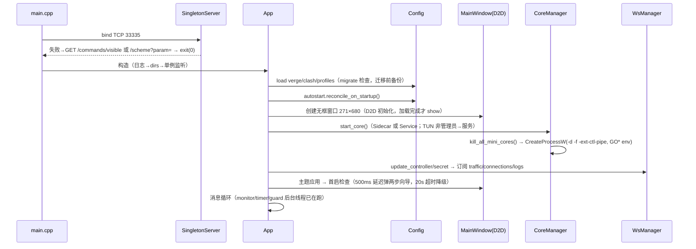
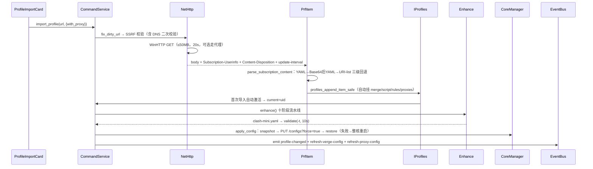
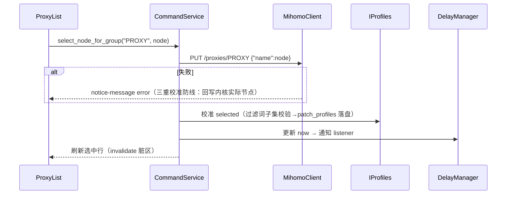
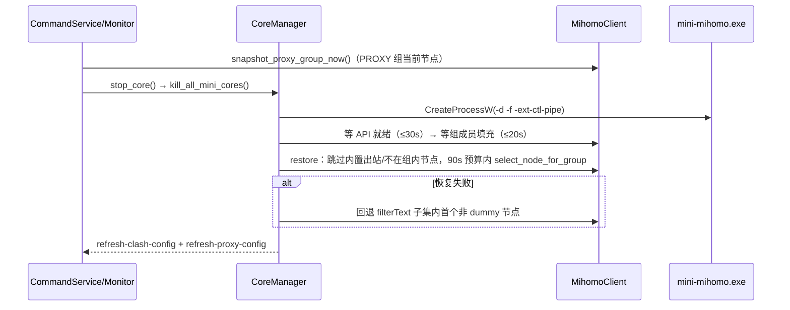
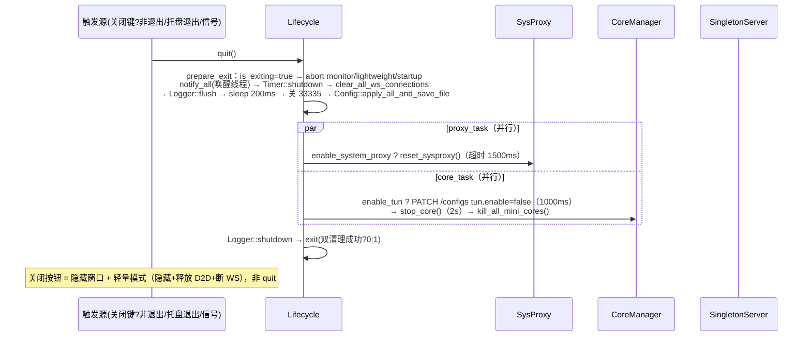
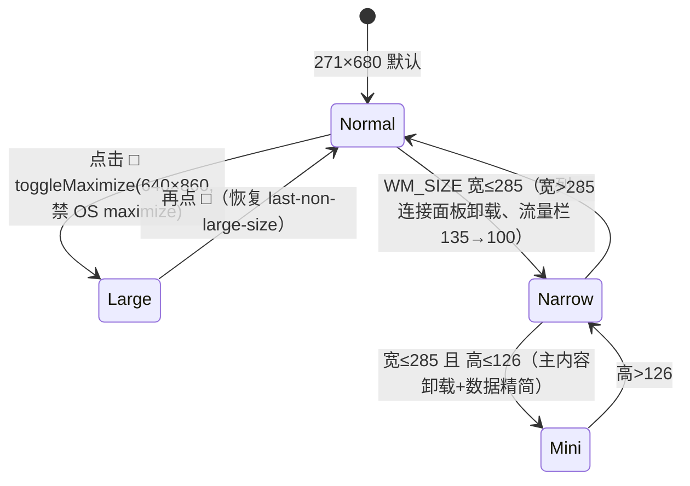
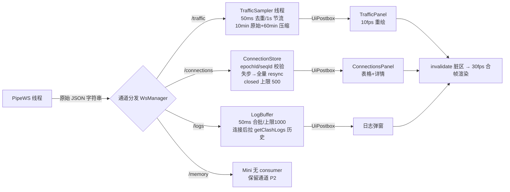

# ClashWin C++20 架构设计（阶段二）

> 架构师 Bob（高见远）· 2026-10-24
> 输入：phase1 全部四份报告 + 4 张 UI 截图 + 8 项用户裁定。
> 目标：Clash Mini（Tauri+React+Rust）→ ClashWin（C++20 / Win32 / Direct2D / DirectWrite / WinHTTP / SCM），四同（外观/功能/行为/结果）。
> 本文档假设：mihomo 通信 = 命名管道 `\\.\pipe\mini-mihomo` 上 HTTP/1.1 + WS；服务通信 = `\\.\pipe\clash-verge-service` 上 HTTP/1.1（X-IPC-Magic 鉴权）；两者共用同一管道 HTTP 客户端层。
> 任务分解见 `06_task_breakdown.md`（从 Walking Skeleton 到全功能，每任务一次可编译提交）。

---

## 1. 实现方案与框架选型

### 1.1 核心技术难点与对策

| # | 难点 | 对策 |
|---|------|------|
| 1 | React 声明式 UI → 命令式自绘 | 自建轻量 Retained Widget 树（measure/layout/draw/hittest 四段式），结构 1:1 镜像 React 组件树（§5）；脏区失效 + 统一 30fps 合帧，流量图区独立 10fps 定时器 |
| 2 | HTTP/1.1 + WS over named pipe（无现成库） | 自研薄层 `PipeHttpClient`：CreateFile 打开管道 → 手写 HTTP/1.1 序列化/解析 → WS Upgrade 帧编解码（RFC6455 最小集）；连接池 min3/max16/idle30s/BUSY 重试 24×125ms 逐常量复刻 |
| 3 | enhance 流水线行为一致（G3 最险） | 逐函数移植 enhance/mod.rs + 子模块；YAML 全程保持 yaml-cpp Node 原生序（禁止转 std::map）；规则链顺序、PROXY__METRICS、gfwlist 位置、MATCH 兜底方向逐行对照；用"同订阅双开 diff clash-mini.yaml"作为每切片回归门 |
| 4 | JS 合并脚本 | vendored QuickJS：每脚本一次 runtime+context，3s 超时（看门狗中断 handler），仅暴露 `function main(config, profileName)` 约定 |
| 5 | sysproxy 行为一致 | 严格按 04§5 复刻：写走 `InternetSetOptionW(INTERNET_OPTION_PER_CONN_OPTION)`（LAN + RasEnumEntriesW 每条 RAS/VPN），读走注册表；广播 PROXY_SETTINGS_CHANGED + REFRESH |
| 6 | 事件/防抖/节流一致性 | 内部 EventBus 观察者注册表 + 每事件常量表（250ms 防抖 / 200·800ms 节流），常量集中在 `events/event_names.h`，一处定义 |
| 7 | 极小窗/窄窗/大尺寸断点 | 窗口状态机（§5.3）驱动 Widget 树挂载/卸载，镜像 React unmount 语义（卸载即停订阅、停采样） |

### 1.2 框架与库选型（全部决策已定或最小化引入）

| 库 | 用途 | 理由 / 替代方案否决 |
|----|------|------|
| **yaml-cpp**（vendored 源码） | 全部 YAML 读写（config/verge/profiles/clash-mini.yaml/enhance） | 用户已定；Node 保留插入序，满足规则链顺序要求 |
| **QuickJS**（vendored 源码，单个 amalgamation 可用 bellard 原版） | Merge/Script JS 引擎全量移植 | 用户已定；duktape 无 ES2020 支持被否决 |
| **nlohmann/json**（vendored 单头） | 内部 JSON（WS 载荷、命令层 DTO、配置 JSON 文件） | 仅内部数据交换、不接触外部行为面；手写 JSON 解析器得不偿失 |
| Win32 原生 | 窗口/消息/SCM/注册表/剪贴板/Shell/RAS | 零依赖 |
| Direct2D + DirectWrite 原生 | 渲染与文字 | 零依赖；DirectWrite 满足 12px 基准 iOS 风字形 |
| WinHTTP | 订阅下载 / 内核升级 / 解锁检测 | 支持代理路由与中断；WinInet 仅用于 sysproxy API（InternetSetOptionW） |
| 自研 | 管道 HTTP/WS、事件总线、Widget 树、Result | 无合适的现成小库；自研可控且总量 <6k 行 |

**否决项**：Boost.Asio（过重）、cpr/libcurl（引入运行时 DLL，且 SSRF 校验逻辑自持）、fmt（std::format C++20 已够——MSVC 19.3x 支持）、spdlog（自研 200 行足够对齐 clash-verge-logging 行为）。

### 1.3 架构模式与总原则

- **进程模型**：单进程。原 Tauri command IPC 变为**进程内门面 `CommandService`**（同语义、同参数、同超时梯度），原 Tauri 事件变为**进程内 EventBus**；对外行为面（TCP 33335 单实例、管道 mihomo、服务管道）与原版逐字节同构。
- **模式**：分层 + 模块单例（镜像 Rust 侧 global 单例习惯）+ Widget 树（UI）+ 观察者（事件）。
- **线程模型**：
  - UI 线程：HWND 消息循环 + Widget 树 + 渲染（唯一触碰 D2D 的线程）。
  - WS 线程（每通道一个 jthread）：读管道 → 解析 → 投递 UI 队列。
  - 后台 jthread：monitor 守护、timer 定时器、guard_monitor 代理守护、下载/测速/解锁检测。
  - 跨线程通信：`UiPostbox`（互斥队列 + PostMessage WM_APP_DISPATCH 到 UI 线程），UI 线程每帧排空。
- **错误处理**：`Result<T, Error>`（自研 30 行，C++20 无 std::expected）；Error{code, message}；管道/HTTP 层错误码对齐原插件 error.rs 分类。
- **编译**：MSVC `/std:c++20 /utf-8 /W4`，静态链接 CRT（/MT），单 exe + sidecar 资源目录。

### 1.4 CMake 结构

```
CMakeLists.txt              # 根：project(clashwin)，C++20，/MT，WIN32 可执行
├── cmake/
│   ├── deps.cmake          # 注册 third_party 三个目标（yaml-cpp/quickjs/nlohmann 接口库）
│   ├── compiler.cmake      # MSVC 选项（/utf-8 /W4 /permissive- /Zi）
│   └── copy_resources.cmake# 构建后拷贝 sidecar/ resources/ locales/ 到输出目录
├── third_party/            # vendored 源码（yaml-cpp/, quickjs/, nlohmann/）
└── src/                    # 模块级 CMakeLists（每模块一个 static library 目标）
    ├── util/      → clashwin_util.lib
    ├── config/    → clashwin_config.lib
    ├── enhance/   → clashwin_enhance.lib
    ├── mihomo/    → clashwin_mihomo.lib
    ├── core/      → clashwin_core.lib
    ├── cmd/       → clashwin_cmd.lib
    ├── system/    → clashwin_system.lib
    ├── events/    → clashwin_events.lib
    ├── i18n/      → clashwin_i18n.lib
    ├── update/    → clashwin_update.lib
    ├── ui/        → clashwin_ui.lib（render/widgets/scenes/window）
    └── main.cpp   → clashwin.exe
```

---

## 2. 文件列表（含来源映射）

> 约定：`include/clashwin/<module>/` 为模块公共头；`src/<module>/` 为实现。每文件一句话职责 + `←` 指向 ClashVerge 参考源。行为常量一律 `← 02附录`。

### 2.0 工程根

| 文件 | 职责 | 来源映射 |
|------|------|---------|
| `CMakeLists.txt` | 根构建脚本：C++20/MT/图标版本资源 | — |
| `cmake/deps.cmake` | 第三方目标注册 | — |
| `cmake/compiler.cmake` | MSVC 编译选项 | — |
| `cmake/copy_resources.cmake` | 拷贝 sidecar、icons、locales | — |
| `src/clashwin.rc` / `src/app.manifest` | 版本资源、DPI per-monitor-v2 清单、图标 | `assets/icon.ico`（本仓库 resources/） |
| `third_party/{yaml-cpp,quickjs,nlohmann}/` | vendored 依赖 | — |
| `assets/locales/{zh,en,ru,fa,tt,id,ar,ko,tr,de,es,jp,zhtw}/*.json` | 13 语言 × 10 命名空间文案（从 ClashVerge 只读复制） | `src/locales/` |

### 2.1 util/

| 文件 | 职责 | 来源映射 |
|------|------|---------|
| `include/clashwin/util/log.h` `src/util/log.cpp` | 日志门面（级别/滚动/max_count）+ flush/shutdown | `core/logger.rs`、`clash-verge-logging` |
| `include/clashwin/util/result.h` | `Result<T,Error>`、Error{code,message} | `mihomo/error.rs` |
| `include/clashwin/util/utf.h` `src/util/utf.cpp` | UTF-8↔UTF-16 转换（Win32 边界专用） | — |
| `include/clashwin/util/json_utils.h` `src/util/json_utils.cpp` | nlohmann 安全取值/类型转换助手 | `mihomo/utils.rs` |
| `include/clashwin/util/yaml_utils.h` `src/util/yaml_utils.cpp` | YAML 序列化（保插入序）、深合并 helper | `enhance/merge.rs` 共用 |
| `include/clashwin/util/base64.h` `src/util/base64.cpp` | standard/urlsafe/补 padding 鲁棒解码 | `universal_parser.rs::decode_base64_robust` |
| `include/clashwin/util/str_utils.h` `src/util/str_utils.cpp` | trim/split/icase/fix_dirty_url/percent-decode | `utils/help.rs`、`prfitem.rs` |
| `include/clashwin/util/debounce.h` | 防抖/节流模板（毫秒常量参数化） | `utils/debounce.ts`、lib.rs 各常量 |
| `include/clashwin/util/dirs.h` `src/util/dirs.cpp` | app_home_dir 便携/APPDATA 分支、全部配置文件路径 | `utils/dirs.rs` |
| `include/clashwin/util/speed.h` `src/util/speed.cpp` | 字节速率格式化 | `utils/speed.rs` |
| `include/clashwin/util/parse_traffic.h` `src/util/parse_traffic.cpp` | 流量字节数解析 | `utils/parse-traffic.ts` |
| `src/util/uuid.cpp` `include/clashwin/util/uuid.h` | uid 生成（profile uid） | `utils/help.rs::random_uid` |

### 2.2 config/

| 文件 | 职责 | 来源映射 |
|------|------|---------|
| `include/clashwin/config/verge.h` `src/config/verge.cpp` | IVerge 全字段 + patch 联动 + 默认值/端口守卫 | `config/verge.rs` |
| `include/clashwin/config/clash.h` `src/config/clash.cpp` | IClashTemp + 模板（tun/dns/profile/secret 默认）+ 端口 0/越界回退 + controller 端口冲突寻位 | `config/clash.rs` |
| `include/clashwin/config/profiles.h` `src/config/profiles.cpp` | IProfiles：items/current、append/reorder/delete、自动挂载 merge/script/rules/proxies 子项、文件名 R/L/m/s/r/p/g+uid 规则 | `config/profiles.rs` |
| `include/clashwin/config/prfitem.h` `src/config/prfitem.cpp` | PrfItem/PrfOption/PrfSelected、from_url 下载管线、from_url_direct（L_Direct_Imports）、Subscription-Userinfo 解析 | `config/prfitem.rs` |
| `include/clashwin/config/config.h` `src/config/config.cpp` | Config 门面：三份配置载入/apply_all_and_save_file/崩溃回滚 | `config/config.rs`、`clash-verge-draft` |
| `include/clashwin/config/draft.h` | Draft<T> 草稿-提交包装 | `clash-verge-draft` crate |
| `include/clashwin/config/migrate.h` `src/config/migrate.cpp` | 版本迁移（verge v3/clash v2/profiles v1，迁移前强制备份） | `config/migrate.rs` |
| `include/clashwin/config/window_state.h` `src/config/window_state.cpp` | window_state.json：1s 节流+尾随补写+版本号防乱序+0×0 守卫+脱屏居中 | `utils/window_manager.rs` |
| `include/clashwin/config/proxy_head_state.h` `src/config/proxy_head_state.cpp` | proxy_head_state.json 读写 | `cmd/proxy.rs` |
| `include/clashwin/config/unlock_cache.h` `src/config/unlock_cache.cpp` | 解锁检测结果缓存 | `clash_verge_unlock_results/time` |

### 2.3 mihomo/（管道通信层）

| 文件 | 职责 | 来源映射 |
|------|------|---------|
| `include/clashwin/mihomo/pipe_http.h` `src/mihomo/pipe_http.cpp` | **共用** HTTP/1.1 over named pipe 客户端 + 连接池（min3/max16/idle30s/健康检查60s/BUSY 24×125ms） | `crates/mihomo/ipc.rs` |
| `include/clashwin/mihomo/pipe_ws.h` `src/mihomo/pipe_ws.cpp` | WS（RFC6455 最小集）over 同管道，Upgrade/Bearer 鉴权/帧编解码/心跳 | `mihomo.rs` WS 部分 |
| `include/clashwin/mihomo/http_types.h` | HttpRequest/HttpResponse/头集合共用类型 | — |
| `include/clashwin/mihomo/mihomo_client.h` `src/mihomo/mihomo_client.cpp` | REST 端点全集（02§6 清单逐条）+ Bearer secret | `mihomo.rs`（1304 行） |
| `include/clashwin/mihomo/ws_manager.h` `src/mihomo/ws_manager.cpp` | traffic/memory/connections/logs 四通道订阅管理：引用计数、断线重连、ws_disconnect、clear_all_ws_connections | `use-mihomo-ws-subscription.ts`、`mihomo.rs` |
| `include/clashwin/mihomo/service_ipc.h` `src/mihomo/service_ipc.cpp` | clash-verge-service 客户端：X-IPC-Magic 头、/version /status /clash/logs /clash/start DELETE /clash/stop PUT /writer GET /magic；{code,message,data} code>0 即失败 | `clash-verge-service-ipc`（04§6） |

### 2.4 core/（内核生命周期）

| 文件 | 职责 | 来源映射 |
|------|------|---------|
| `include/clashwin/core/core_manager.h` `src/core/core_manager.cpp` | RunningMode{Service,Sidecar,NotRunning}、lifecycle 锁、start/stop/restart、kill_all_mini_cores（Toolhelp32 扫描）、启动参数 -d -f -ext-ctl-pipe + GO* 环境变量 | `core/manager/*`、`core/service.rs` |
| `src/core/service_mode.cpp` | 服务模式：SCM 查询/启停、start_with_existing_service（stop_clash→等端口 50ms×3s→start_clash payload）、SERVICE_WAIT_MAX 30s/200ms | `core/service.rs` |
| `include/clashwin/core/validate.h` `src/core/validate.cpp` | clash-mini-check.yaml + `mini-mihomo -t`（10s）→ Valid/Invalid/Skipped/Busy | `core/validate.rs` |
| `include/clashwin/core/monitor.h` `src/core/monitor.cpp` | 守护线程：15s/3s/5s、连续2次判死、自愈选点、3次→restart_core、5次→MessageBoxW、宽限60s/冷却60s/失败服务器600s/history60s/子集复用30s | `module/monitor.rs`（1656 行） |
| `include/clashwin/core/timer.h` `src/core/timer.cpp` | 订阅定时更新：interval 分钟（默认1440）、过期补跑、失败 2min 重试、与切换互斥 | `core/timer.rs` |
| `include/clashwin/core/core_updater.h` `src/core/core_updater.cpp` | check_core_update（GitHub API）+ start_core_upgrade（下载+sha256+热替换+core-upgrade-progress 事件 checking5→downloading→verifying85→extracting90→done100/error0） | `core/core_updater.rs` |
| `include/clashwin/core/autostart.h` `src/core/autostart.cpp` | HKCU Run 键 "Clash Mini"（带 --silent）+ reconcile_on_startup + schtasks 清理标记 | `core/autostart.rs` |

### 2.5 enhance/（配置增强流水线）

| 文件 | 职责 | 来源映射 |
|------|------|---------|
| `include/clashwin/enhance/enhance.h` `src/enhance/enhance.cpp` | 主流水线十阶段编排（02§4 ①~⑩ 逐条） | `enhance/mod.rs`（1273 行） |
| `src/enhance/merge.cpp` | Merge.yaml：prepend/append/delete + 字段覆盖 | `enhance/merge.rs` |
| `src/enhance/seq.cpp` | seq 数组操作（rules/proxies 的 prepend/append/delete） | `enhance/seq.rs` |
| `src/enhance/field.cpp` | 字段级增强 | `enhance/field.rs` |
| `src/enhance/chain.cpp` | profile 级 Rules/Proxies/Merge/Script 链 | `enhance/chain.rs` |
| `src/enhance/tun.cpp` | use_tun：dns 强制/fake-ip filter/inet6-address/防泄漏 | `enhance/tun.rs` |
| `src/enhance/mini_agreements.cpp` | enforce_mini_agreements：PROXY(select)+PROXY__METRICS(url-test 300)+gfwlist+DNS 对偶+GEOIP,CN+MATCH 兜底 + dummy/server 无效过滤 | `enhance/mod.rs` 内函数 |
| `src/enhance/dns_defaults.cpp` | apply_mandatory_dns_settings（仅补缺） | `enhance/mod.rs` 内函数 |
| `include/clashwin/enhance/js_engine.h` `src/enhance/js_engine.cpp` | QuickJS 封装：runtime/context/3s 看门狗/main(config, profileName) 约定 | `enhance/script.rs` |
| `include/clashwin/enhance/uri_list.h` `src/enhance/uri_list.cpp` | URI-list 解析（vmess/ss/trojan/vless/hysteria2/hysteria/anytls/tuic/wireguard/socks5/http 兜底） | `utils/resolve/universal_parser.rs`（2008 行） |

### 2.6 events/ + cmd/

| 文件 | 职责 | 来源映射 |
|------|------|---------|
| `include/clashwin/events/event_names.h` | 全部事件名常量 + 防抖/节流常量表（唯一事实来源） | `core/notification.rs`、`use-layout-events.ts` |
| `include/clashwin/events/event_bus.h` `src/events/event_bus.cpp` | 观察者注册表：subscribe/emit、每事件防抖节流策略、IEventSink 接口 | — |
| `include/clashwin/events/notice.h` `src/events/notice.cpp` | Snackbar 通知服务（50 条上限，success 3000/info 5000/error 8000ms） | `services/notice-service.ts`、`notice-manager` |
| `include/clashwin/cmd/command_service.h` `src/cmd/command_service.cpp` | CommandService 门面 + 分发表 + 超时梯度（10/15/30/60s） | `lib.rs::generate_handler` |
| `src/cmd/cmd_profile.cpp` | profile 全命令 + enhance_profiles→ValidationOutcome + patch_profiles_config 切换失败回滚 | `cmd/profile.rs`、`cmd/save_profile.rs` |
| `src/cmd/cmd_clash.cpp` | clash 命令：test_delay（失败10000/超时2000）、restart_core、get_clash_info 等 | `cmd/clash.rs` |
| `src/cmd/cmd_verge.cpp` `src/cmd/cmd_system.cpp` | verge/system 命令 | `cmd/verge.rs`、`cmd/system.rs` |
| `src/cmd/cmd_service.cpp` `src/cmd/cmd_lightweight.cpp` | 服务安装卸载重装修复 + entry/exit_lightweight_mode | `cmd/service.rs`、`cmd/lightweight.rs` |
| `src/cmd/cmd_network.cpp` | get_sys_proxy/get_auto_proxy/is_port_in_use/网络接口 | `cmd/network.rs` |
| `src/cmd/cmd_proxy.cpp` | trigger_auto_select/get_proxy_addr/proxy_head_state | `cmd/proxy.rs` |
| `src/cmd/cmd_media.cpp` `src/cmd/cmd_diagnostics.cpp` | 解锁检测 12 项 + 诊断包 | `cmd/media_unlock_checker/`、`cmd/diagnostics.rs` |

### 2.7 system/

| 文件 | 职责 | 来源映射 |
|------|------|---------|
| `include/clashwin/system/sysproxy.h` `src/system/sysproxy.cpp` | **PER_CONN_OPTION 写 + RAS 枚举 + 注册表读 + 广播**，默认 bypass 列表，PAC URL :33335/commands/pac，顺序规则（纯全局先清 PAC…） | `core/sysopt.rs` + `sysproxy-rs windows.rs`（04§5） |
| `include/clashwin/system/guard_monitor.h` `src/system/guard_monitor.cpp` | 代理守护：每 proxy_guard_duration（默认30s）重写 | `sysproxy::GuardMonitor` |
| `include/clashwin/system/tray.h` `src/system/tray.cpp` | Shell_NotifyIcon：2 项菜单（轻量模式勾选/退出）、三态图标内嵌、左键唤醒 300ms 防抖、tooltip "Clash Mini" | `core/tray/mod.rs` |
| `include/clashwin/system/scmanager.h` `src/system/scmanager.cpp` | OpenSCManager/StartService/QueryService + ShellExecuteW runas UAC + install/uninstall exe | `core/service.rs` SCM 部分 |
| `include/clashwin/system/net_http.h` `src/system/net_http.cpp` | WinHTTP：get_with_interrupt、ProxyType{None,System,Localhost}、SSRF 校验（私网/链路本地/ULA/DNS 二次校验）、50MB 上限 | `utils/network.rs`、`prfitem.rs` |
| `include/clashwin/system/unlock_checker.h` `src/system/unlock_checker.cpp` `src/system/unlock_platforms.cpp` | 12 项平台并发检测 | `cmd/media_unlock_checker/` |
| `include/clashwin/system/signals.h` `src/system/signals.cpp` | Ctrl+C/Close/Shutdown/Logoff → quit | `clash-verge-signal` |
| `include/clashwin/system/clipboard.h` `src/system/clipboard.cpp` | 剪贴板读写 | `plugin-clipboard-manager` |
| `include/clashwin/system/shell_utils.h` `src/system/shell_utils.cpp` | open_web_url（仅 http/https）/show_in_folder/打开目录/用系统编辑器打开 | `cmd/app.rs` |
| `include/clashwin/system/icon_cache.h` `src/system/icon_cache.cpp` | 节点图标下载缓存 | `feat/icon.rs` |

### 2.8 app/（应用壳）

| 文件 | 职责 | 来源映射 |
|------|------|---------|
| `include/clashwin/app/app.h` `src/app/app.cpp` | 装配：单实例→配置→窗口→内核→WS→托盘→事件循环；模块单例持有 | `lib.rs` 507 行 |
| `include/clashwin/app/singleton.h` `src/app/singleton.cpp` | TCP 33335 bind 抢占 + /commands/visible 唤醒 + /commands/scheme 深链转发 + 首实例 listener 复用为 embed server（含 /commands/pac） | `utils/server.rs` |
| `include/clashwin/app/scheme.h` `src/app/scheme.cpp` | clash://(verge/mini) 导入订阅：name/url、双解码、剥 [...]、仅此前无 current 才 update_config_forced | `utils/resolve/scheme.rs`（04§4） |
| `include/clashwin/app/lifecycle.h` `src/app/lifecycle.cpp` | quit/restart_app 完整序列（04§7 逐行）+ 轻量模式 entry/exit（隐藏窗口+释放 D2D+断 WS） | `feat/window.rs`、`module/lightweight.rs` |

### 2.9 update/

| 文件 | 职责 | 来源映射 |
|------|------|---------|
| `include/clashwin/update/client_updater.h` `src/update/client_updater.cpp` | 客户端自更新 check/download/install（updater manifest 机制待确认，见 §10） | `plugin-updater` |
| `include/clashwin/update/update_check.h` `src/update/update_check.cpp` | 帮助菜单"检查更新"两入口共用 | `use-client-update.ts`、`use-core-update.ts` |

### 2.10 i18n/

| 文件 | 职责 | 来源映射 |
|------|------|---------|
| `include/clashwin/i18n/i18n.h` `src/i18n/i18n.cpp` | 13 语言 JSON 加载、fallback=zh、zh-cn→zh/zh-tw→zhtw 归一、verge-language 持久化、switchLanguage→patchVerge | `services/i18n.ts`、`locales/` |

### 2.11 ui/

| 文件 | 职责 | 来源映射 |
|------|------|---------|
| **render/** | | |
| `include/clashwin/ui/d2d_context.h` `src/ui/d2d_context.cpp` | D2D1Factory/DWriteFactory/HwndRenderTarget 生命周期、设备丢失恢复 | — |
| `include/clashwin/ui/render_target.h` `src/ui/render_target.cpp` | IRenderTarget：DrawText/Geometry/FillBrush/位图封装（Widget 树唯一绘制接口） | — |
| `include/clashwin/ui/theme.h` `src/ui/theme.cpp` | ThemeParams：亮暗两套 iOS 色板 + CSS 变量系统等价（divider/background/selection/scroller/primary/rgb/window-border/scrollbar/background-opacity/theme-bg/panel/popover/border/input/depth/vibrancy） | `_theme.tsx`、`use-custom-theme.ts:360-527` |
| `include/clashwin/ui/skin_params.h` `src/ui/skin_params.cpp` | 6 套皮肤绘制参数表 + Get3DButton/Card/Input/Segmented 绘制派生 | `utils/button-styles.ts` |
| `include/clashwin/ui/icon_store.h` `src/ui/icon_store.cpp` | 图标位图缓存（app-icon/favicon/订阅节点图标/信号图标） | `use-icon-cache.ts` |
| **widgets/** | | |
| `include/clashwin/ui/widget.h` `src/ui/widget.cpp` | Widget 基类：rect/measure/layout/draw/hittest/invalidate/handleEvent/z 序 | React 组件树等价 |
| `include/clashwin/ui/container.h` `src/ui/container.cpp` | Column/Row/Stack/AbsoluteOverlay（抽屉/弹窗覆盖层） | MUI 布局等价 |
| `include/clashwin/ui/label.h/.cpp`、`button.h/.cpp`、`icon_w.h/.cpp`、`segmented.h/.cpp`、`switch_w.h/.cpp`、`textfield.h/.cpp`、`slider.h/.cpp`、`dropdown.h/.cpp`、`checkbox_w.h/.cpp`、`scroll_list.h/.cpp`（虚拟滚动）、`context_menu.h/.cpp`、`modal.h/.cpp`、`snackbar_w.h/.cpp`、`tooltip_w.h/.cpp` | 自绘控件族 | MUI 组件 + `components/base/*` |
| `include/clashwin/ui/canvas_graph.h` `src/ui/canvas_graph.cpp` | 折线图控件（双折线/无轴/浅灰底） | `traffic-graph.tsx` |
| `include/clashwin/ui/text_viewer.h` `src/ui/text_viewer.cpp` | 只读文本查看器 + "用系统编辑器打开"（Monaco 替代，用户裁定 B） | `MonacoEditor.tsx` |
| **scenes/（1:1 镜像 React 组件树）** | | |
| `include/clashwin/ui/main_window.h` `src/ui/main_window.cpp` | HWND 注册/消息循环/WM_GETMINMAXINFO(271×126~640×860)/WM_SIZING 上缘钳制/8 方向拖拽边/窗口几何/大尺寸 toggleMaximize/激活 trick | `_layout.tsx`、`window_manager.rs`、`lib.rs:354-461` |
| `include/clashwin/ui/breakpoints.h` `src/ui/breakpoints.cpp` | 窗口状态机 Normal/Narrow/Mini/Large + 转换副作用（挂载卸载/流量栏 135→100/极小窗闲置 10s 隐藏标题栏） | `constants.ts`、`WindowProvider` |
| `include/clashwin/ui/title_bar.h` `src/ui/title_bar.cpp` | 30px 标题栏：AppIcon16+Clash Mini Ver.{v}+三键 28×28（close hover 红） | `window-controller.tsx` |
| `include/clashwin/ui/main_scene.h` `src/ui/main_scene.cpp` | 主内容编排：顶栏快捷条/节点列表/流量面板/抽屉/弹窗宿主（`_layout.tsx` 1985 行等价） | `_layout.tsx` |
| `include/clashwin/ui/active_node_card.h` `src/ui/active_node_card.cpp` | 顶栏当前节点卡（名称/协议/延迟/信号/地址 + TEST 按钮/图钉/齿轮） | `active-node-card.tsx` |
| `include/clashwin/ui/proxy_list.h` `src/ui/proxy_list.cpp` | 节点列表：单 PROXY 组、分组头、行高 39、选中橙高亮、虚拟滚动 | `proxy-groups/proxy-item/proxy-head`、`use-render-list.ts` |
| `include/clashwin/ui/traffic_panel.h` `src/ui/traffic_panel.cpp` | 底部 MiniTrafficPanel（135/100px）：流量图+速率两行（浅蓝/浅橙底条） | `mini-traffic-panel.tsx` |
| `include/clashwin/ui/traffic_sampler.h` `src/ui/traffic_sampler.cpp` | Worker 等价采样线程：10min 原始 + 60min 压缩、50ms 去重、1s 节流 | `use-traffic-monitor.ts`、`traffic.worker.ts` |
| `include/clashwin/ui/settings_drawer.h` `src/ui/settings_drawer.cpp` | 全屏覆盖抽屉：左列 240px + 右侧 ConnectionsPanel（≤285 不挂载）+ 底部语言/皮肤条（高≤830 隐藏） | `_layout.tsx` theme-panel |
| `include/clashwin/ui/profile_import_card.h` `src/ui/profile_import_card.cpp` | 订阅卡：粘贴/导入/列表右键/流量信息行 | `profile-import-card.tsx` |
| `include/clashwin/ui/takeover_card.h` `src/ui/takeover_card.cpp` | MAN/SYS/TUN 三段 + 状态行 | `takeover-mode-card.tsx` |
| `include/clashwin/ui/routing_card.h` `src/ui/routing_card.cpp` | DIR/RUL/PRX 三段 + 添加自定义分流按钮 | `routing-preference-card.tsx` |
| `include/clashwin/ui/basic_card.h` `src/ui/basic_card.cpp` | 2×2 开关 + Mixed Port + 保存 | `basic-settings-card.tsx` |
| `include/clashwin/ui/theme_card.h` `src/ui/theme_card.cpp` | 6 皮肤格/SYS-LIGHT-DARK/Depth/Vibrancy 滑块 | `theme-settings-card.tsx` |
| `include/clashwin/ui/connections_panel.h` `src/ui/connections_panel.cpp` | 连接表：列管理/排序/右键复制断开/详情 Popover/close_all、snapshot+delta 重同步 | `connection-table/detail`、`use-connection-data.ts` |
| `include/clashwin/ui/connection_store.h` `src/ui/connection_store.cpp` | 连接数据状态：epochId/sequenceId 校验、delta 合并（步长3扁平数组）、closed 上限 500 | `use-connection-data.ts:58-207` |
| `include/clashwin/ui/dialogs.h` `src/ui/dialogs.cpp` | 弹窗宿主 + 首次向导两步（500ms 延迟、20s 超时降级、稍后→抽屉） | `first-run-guide-dialog`、`layout-dialogs` |
| `include/clashwin/ui/add_url_dialog.h` `src/ui/add_url_dialog.cpp` | 添加自定义分流规则弹窗（360×290） | `add-url-dialog.tsx` |
| `include/clashwin/ui/unlock_dialog.h` `src/ui/unlock_dialog.cpp` | 解锁检测弹窗（360×620、缓存显示/重检按钮） | `pages/unlock.tsx`、`clashwin_modal_unlock.png` |
| `include/clashwin/ui/log_dialog.h` `src/ui/log_dialog.cpp` | 日志弹窗（LogBuffer 50ms 合批/上限1000 + getClashLogs 历史） | `layout-dialogs`、`use-log-data.ts` |
| **状态层** | | |
| `include/clashwin/ui/app_state.h` `src/ui/app_state.cpp` | AppState 聚合：7 Context 等价（Proxies/Rules/ClashConfig/System/Uptime/CoreDataStatus/Refreshers + WindowContext + ThemeMode）+ queryKey 语义等价缓存（staleTime∞/retry 3×5s） | `app-data-provider.tsx` |
| `include/clashwin/ui/delay_manager.h` `src/ui/delay_manager.cpp` | DelayManager：TTL 30min、历史回落 10min、NODE_DELAY 30ms/2000ms 判死、批量注入 listener | `services/delay.ts`、`use-proxy-delay-state.ts` |
| `include/clashwin/ui/ui_postbox.h` | 跨线程→UI 线程投递队列（WM_APP_DISPATCH） | — |

> **计数**：约 100 个源文件（include+src），与 phase1 前端 230 文件 + 后端 96 文件的规模经去死代码（P2 六项）后对应收敛。

---

## 3. 数据结构与接口（C++ 头文件形式）

### 3.1 核心数据模型（`include/clashwin/config/models.h` 摘要，完整字段以源码为准）

```cpp
#pragma once
#include <string>
#include <vector>
#include <optional>
#include <cstdint>
#include "clashwin/util/result.h"

namespace clashwin {

// ---------- 行为常量（唯一事实来源：phase1 02 附录 + 04 裁定） ----------
namespace consts {
inline constexpr uint16_t kMixedPort = 10801, kSocksPort = 10802, kHttpPort = 10803;
inline constexpr uint16_t kControllerPort = 9098, kSingletonPort = 33335;  // dev 33336
inline constexpr const wchar_t* kMihomoPipe = L"\\\\.\\pipe\\mini-mihomo";
inline constexpr const wchar_t* kServicePipe = L"\\\\.\\pipe\\clash-verge-service";
inline constexpr const char*    kServiceMagic =
  "A thing of beauty is a joy for ever. Its loveliness increases; it will never pass into nothingness.";
inline constexpr int kProbeTimeoutMs = 2000;     // 测速探针
inline constexpr int kTestDelayFailValue = 10000;
inline constexpr int kValidateTimeoutS = 10;     // -t 校验
inline constexpr int kScriptTimeoutS = 3;        // JS 脚本
inline constexpr int kServiceWaitMaxS = 30, kServiceWaitIntervalMs = 200;
inline constexpr int kProfileTimeoutS = 20;      // 订阅下载默认
inline constexpr size_t kSubscriptionMaxBytes = 50u << 20;
inline constexpr int kDebounceRefreshMs = 250;   // refresh-clash/verge-config
inline constexpr int kThrottleProxyMs = 200, kThrottleProfileMs = 800;
inline constexpr int kTrayDebounceMs = 300, kWindowDebounceMs = 625, kWindowIdleExemptMs = 3000;
inline constexpr int kGuardIntervalS = 30;       // proxy_guard_duration 默认
inline constexpr int kMiniIdleHideTitlebarS = 10;
inline constexpr int kDelayTtlMin = 30, kDelayHistoryMaxMin = 10;
inline constexpr int kDelayAliveMinMs = 30, kDelayAliveMaxMs = 2000;
inline constexpr int kMonitorNormalS = 15, kMonitorRetryS = 3, kMonitorOfflineS = 5;
inline constexpr int kMonitorGraceS = 60, kMonitorHealCooldownS = 60,
                     kMonitorFailServerCooldownS = 600, kMonitorHistoryFreshS = 60,
                     kMonitorSubsetReuseS = 30;
inline constexpr int kRestoreWaitApiS = 30, kRestoreWaitMembersS = 20, kRestoreBudgetS = 90;
}  // namespace consts

// ---------- PrfItem（← config/prfitem.rs:20-64） ----------
enum class PrfType { Remote, Local, Merge, Script, Rules, Proxies, Groups };

struct PrfSelected { std::string name; std::optional<std::string> now; };

struct PrfOption {
  std::optional<std::string> user_agent;
  bool with_proxy = false, self_proxy = false;
  std::optional<int> update_interval;             // 分钟
  int timeout_seconds = 20;
  bool danger_accept_invalid_certs = false;
  bool allow_auto_update = true;
  std::optional<std::string> merge, script, rules, proxies, groups;
};

struct PrfExtra { int64_t upload = 0, download = 0, total = 0; int64_t expire = 0; };

struct PrfItem {
  std::string uid;                                 // 22 位随机串
  PrfType type = PrfType::Remote;
  std::string name, file, desc, url, home;
  std::vector<PrfSelected> selected;
  std::optional<PrfExtra> extra;
  int64_t updated = 0;
  PrfOption option;

  static Result<PrfItem> from_url(const std::string& url, const PrfOption& opt);   // 下载+解析+落盘
  static Result<PrfItem> from_url_direct(const std::string& uris);                 // L_Direct_Imports.yaml
  Result<void> update();            // 重新下载（保留 uid/name/option）
  std::string file_path() const;    // profiles/<type 前缀><uid><ext>
};

struct IProfiles {
  int config_version = 1;
  std::optional<std::string> current;
  std::vector<PrfItem> items;
  const PrfItem* current_item() const;
  void append_item(PrfItem&& item);   // 自动挂载 merge/script/rules/proxies 子项
};

// ---------- IClashTemp（← config/clash.rs，Mapping 语义：键动态存在） ----------
struct IClashTemp {
  YAML::Node mapping;                              // 保留插入序与未知键
  int config_version = 2;
  uint16_t mixed_port() const;  bool allow_lan() const;  bool ipv6() const;
  std::string mode() const;                        // rule/global/direct
  // guard：端口 0/越界回退默认；controller 端口冲突自动从 9098 起寻空闲
  Result<void> sanitize_ports();
};

// ---------- IVerge（← config/verge.rs:23-192，节选；全字段见实现） ----------
struct IVergeTheme {
  std::optional<std::string> background_image, background_blend_mode;
  std::optional<double> background_opacity, primary_color;
  std::optional<int> primary_color_rgb;           // --primary-color-rgb
  std::optional<std::string> info_color, error_color, warning_color, success_color;
};

struct IVerge {
  int config_version = 3;
  std::string language = "zh";
  std::string theme_mode = "system";               // system/light/dark
  bool enable_tun_mode = false, enable_system_proxy = false;
  bool enable_auto_launch = false, enable_silent_start = false;
  bool enable_proxy_guard = true;
  std::string system_proxy_bypass;                 // 空 = 默认 bypass
  int proxy_guard_duration = 30;
  bool enable_auto_light_weight_mode = false; int auto_light_weight_minutes = 10;
  int verge_mixed_port = 10801, verge_socks_port = 10802, verge_port = 10803;
  bool verge_socks_enabled = false, verge_http_enabled = false;
  std::string rule_fallback = "direct";            // proxy|direct|addurl（出厂 direct）
  std::string control_skin = "retro-3d";           // 6 套皮肤
  IVergeTheme theme_setting;
  int app_log_max_count = 100;
  std::string auto_log_clean = "preserve";
  bool enable_builtin_enhanced = true;
  int default_latency_test = 2000;
  bool enable_auto_delay_detection = false; int auto_delay_detection_interval = 10;
  bool enable_external_controller = true;
  std::string clash_core = "mini-mihomo";
  // ……其余字段按 verge.rs 全量补齐
};

// ---------- enhance 中间节点（← enhance/chain.rs 的 chain 概念） ----------
enum class EnhanceStageKind {
  GlobalMerge, GlobalScript, ProfileRules, ProfileProxies,
  ProfileMerge, ProfileScript, BuiltinScript, MergeDefault,
  MiniAgreements, UseTun, UseSort, MandatoryDns
};

struct EnhanceNode {                               // PipelineNode 等价
  EnhanceStageKind kind;
  const PrfItem* item = nullptr;                   // 关联子项（可空）
  Result<void> run(YAML::Node& config) const;      // 原地改写运行时配置
};

struct EnhanceContext {
  const IClashTemp& clash;  const IProfiles& profiles;  const IVerge& verge;
  YAML::Node merged_config;                        // clash-mini.yaml 中间态
  std::vector<EnhanceNode> build_chain() const;    // 十阶段顺序（02§4 ①~⑩）
  Result<std::string> generate();                  // 产出 clash-mini.yaml 文本
};
}  // namespace clashwin
```

### 3.2 运行时/WS 数据模型（`include/clashwin/mihomo/models.h`）

```cpp
namespace clashwin {

// ---------- 连接面板 snapshot+delta（← use-connection-data.ts:58-207） ----------
struct ConnMeta { std::string network, type, source_ip, source_port, host,
                  destination_ip, destination_port, process, process_path;
                std::vector<std::string> chains; int64_t start; };
struct ConnectionItem { std::string id; ConnMeta metadata; int64_t upload, download;
                        int64_t start_ms; std::vector<std::string> chains; };
struct ConnectionsSnapshot {
  uint64_t epoch_id, sequence_id;
  int64_t upload_total, download_total;
  std::vector<ConnectionItem> connections;
};
struct ConnectionsDelta {
  uint64_t epoch_id, sequence_id;
  int64_t upload_total, download_total;
  std::vector<ConnectionItem> added;
  std::vector<std::string> removed;
  std::vector<std::tuple<std::string,int64_t,int64_t>> updated;  // [id,up,down] 扁平步长3
};
// 校验规则：epochId≠当前 或 sequenceId≠last+1 → 全量 resync；closed 保留上限 500

struct TrafficMsg { int64_t up, down; std::optional<int64_t> up_total, down_total; }; // 50ms 去重/1s 节流
struct LogItem { std::string type, payload; };

// ---------- 内核监控（← module/monitor.rs 状态机） ----------
enum class CoreHealth { Starting, Grace, Healthy, Degraded, Offline, Healing };

struct MonitorState {
  CoreHealth health = CoreHealth::Starting;
  int fail_streak = 0, heal_streak = 0;
  int64_t last_check_ms = 0, grace_until_ms = 0, heal_cooldown_until_ms = 0;
  std::string last_error;
  // 常量：15s 常规体检 / 判死后 3s 重试 / 离线后 5s；
  // 连续 2 次判死 → 自愈选点；自愈连败 3 → restart_core；连败 5 → MessageBoxW 警报
};

// ---------- 延迟缓存（← services/delay.ts） ----------
struct DelayRecord { int delay_ms; int64_t updated_ms; };
class DelayManager {                               // 模块级单例，一对多 listener
 public:
  static DelayManager& get();
  void put(const std::string& node, int delay_ms);
  std::optional<int> query(const std::string& node) const;    // TTL 30min / 历史回落 10min
  void inject_batch(const std::string& group,
                    const std::vector<std::pair<std::string,int>>& results);  // backend-delay-results
  int subscribe(std::function<void()> listener); void unsubscribe(int token);
};
}  // namespace clashwin
```

### 3.3 关键接口

```cpp
namespace clashwin {

// ---- 管道 HTTP 客户端（mihomo 与 clash-verge-service 共用实现） ----
struct HttpResponse { int status; std::map<std::string,std::string> headers; std::string body; };
class IPipeHttpClient {
 public:
  virtual ~IPipeHttpClient() = default;
  // 打开 \\.\pipe\{name}，HTTP/1.1 keep-alive；ERROR_PIPE_BUSY 重试 24×125ms
  virtual Result<void> connect(const std::wstring& pipe_name) = 0;
  virtual Result<HttpResponse> send(const std::string& method, const std::string& path,
                                    const std::map<std::string,std::string>& headers,
                                    const std::string& body, int timeout_ms) = 0;
  // 连接池：min 3 / max 16 / idle 30s / 健康检查 60s / 拒绝策略 Timeout 5s
  virtual void set_pool(int min, int max, int idle_s) = 0;
};

// ---- 管道 WS 订阅 ----
class IPipeWebSocket {
 public:
  using MessageCb = std::function<void(const std::string& payload)>;  // 原始 JSON 字符串
  virtual Result<void> connect(const std::wstring& pipe_name, const std::string& path,
                               const std::string& secret, MessageCb cb) = 0;
  virtual void close() = 0;
};

// ---- 后端→UI 事件（原 Tauri emit 等价；轻量模式下 emit 全部过滤 ← notification.rs） ----
class IEventSink {
 public:
  virtual ~IEventSink() = default;
  virtual void emit(const std::string& event, const nlohmann::json& payload) = 0;
};
// EventBus 实现 IEventSink；事件名与防抖策略集中 event_names.h：
//   verge://refresh-clash-config(250ms)  verge://refresh-verge-config(250ms)
//   verge://refresh-proxy-config(200ms)  verge://notice-message
//   profile-changed(800ms)  verge://timer-updated  verge://backend-delay-results
//   profile-update-started/completed  core-upgrade-progress

// ---- 渲染目标（Widget 树唯一绘制面） ----
class IRenderTarget {
 public:
  virtual ~IRenderTarget() = default;
  virtual void fill_rect(const RectF& r, const Brush& b) = 0;
  virtual void round_rect(const RectF& r, float radius, const Pen& p, const Brush* fill) = 0;
  virtual void draw_text(const std::wstring& text, const RectF& r,
                         const TextStyle& ts) = 0;     // TextStyle→DirectWrite
  virtual void draw_bitmap(BitmapId id, const RectF& r, float opacity) = 0;
  virtual void draw_line(const PointF& a, const PointF& b, const Pen& p) = 0;
  virtual void push_clip(const RectF& r) = 0; virtual void pop_clip() = 0;
};

// ---- CommandService 门面（原 Tauri command 等价；签名节选） ----
class ICommandService {
 public:
  virtual ~ICommandService() = default;
  // profiles（超时梯度 30s patch / 60s 导入）
  virtual Result<IProfiles> get_profiles() = 0;
  virtual Result<ValidationOutcome> enhance_profiles() = 0;   // valid/busy/invalid/skipped
  virtual Result<void> patch_profiles_config(std::optional<std::string> current) = 0; // 失败回滚 previous
  virtual Result<PrfItem> import_profile(const std::string& url, PrfOption opt) = 0;
  // clash
  virtual Result<ClashInfo> get_clash_info() = 0;
  virtual Result<int> test_delay(const std::string& node, int timeout_ms = 2000) = 0; // 失败=10000
  virtual Result<void> restart_core() = 0;                    // 快照→重启→恢复(90s)
  // verge / system（10s/15s 探针类）
  virtual Result<SysProxyState> get_sys_proxy() = 0;
  virtual Result<RunningMode> get_running_mode() = 0;
  // ……完整 43+38 命令清单见 phase1 01§5-A/B / 02§2，实现逐条对号
};

// ---- 渲染循环 ----
class IFrameClock {   // 30fps 合帧 + 分区定时
 public:
  virtual void invalidate(const RectF& dirty) = 0;    // 合并脏区，下一帧绘制
  virtual void set_region_timer(RegionId region, int fps) = 0;  // 流量图 10fps
};
}  // namespace clashwin
```

---

## 4. 调用流程

### 4.1 启动流程（← lib.rs + main.tsx bootstrap）



### 4.2 订阅导入流程（← prfitem.rs::from_url + profile 命令）



### 4.3 节点切换流程（← feat/proxy.rs + use-profiles.activateSelected）



### 4.4 enhance 配置生成流水线（← enhance/mod.rs::enhance 956-1022）

```mermaid
flowchart TD
    A[收集 clash.yaml + 当前订阅] --> B[get_merged_proxies<br/>合并全部 remote/local 订阅 proxies<br/>重名加 #n (HHMMSS)]
    B --> C[全局 Merge.yaml + Script.js<br/>QuickJS 3s 超时]
    C --> D[profile 级 Rules/Proxies/Merge/Script 链]
    D --> E[merge_default_config<br/>clash.yaml 键覆盖/tun 深合并/dns-profile 仅补缺<br/>socks-http 未启用删键/剥 config_version]
    E --> F[内置脚本]
    F --> G[enforce_mini_agreements<br/>过滤 dummy/server 无效<br/>注入 PROXY(select)+PROXY__METRICS(url-test 300)<br/>gfwlist RULE-SET + DNS 对偶保通<br/>+GEOIP,CN,DIRECT + MATCH 兜底方向]
    G --> H[use_tun：dns 强制/fake-ip/ipv6 防泄漏]
    H --> I[use_sort]
    I --> J[apply_mandatory_dns_settings 仅补缺]
    J --> K[(clash-mini.yaml)]
    K --> L{validate -t 10s}
    L -- Valid --> M[apply_config 热应用]
    L -- Invalid --> N[ValidationOutcome.invalid → notice + 不应用]
```

### 4.5 内核重启 + 节点恢复（← lifecycle.rs::restart_core）



### 4.6 退出序列（← feat/window.rs:57-76，04§7 逐行）



---

## 5. UI 渲染架构

### 5.1 Widget 树 ↔ React 组件树对应

```
MainWindow (HWND, 无框, D2D HwndRenderTarget)
└─ MainScene                          ← _layout.tsx:1219-1783
   ├─ ResizeHandles(8 方向)           ← resize-handles.tsx（自绘拖拽边，钳制 271×126~640×860）
   ├─ TitleBar(30px)                  ← window-controller.tsx（极小窗闲置 10s 隐藏）
   ├─ Column[layout-content]
   │  ├─ Row[上栏 80%+30px]
   │  │  ├─ Stack(绝对覆盖层)
   │  │  │  ├─ TopQuickBar(30px)：ActiveNodeCard + TEST + 图钉 + 齿轮   ← active-node-card.tsx
   │  │  │  ├─ SettingsDrawer(覆盖层, 关闭时卸载)                      ← theme-panel zIndex100
   │  │  │  │  ├─ 左列 240px：ProfileImportCard → Takeover+Routing → Basic → Theme
   │  │  │  │  ├─ 右列：ConnectionsPanel（宽≤285 不挂载）
   │  │  │  │  └─ 底部：Language 下拉 + 6 格皮肤条（高≤830 隐藏）
   │  │  │  └─ ModalHost（向导/addurl/unlock/编辑/更新×2/日志 + Snackbar）
   │  │  └─ ProxyList（isMiniStatus 时卸载）                          ← proxy-groups
   │  └─ TrafficPanel(固定 135px，窄窗 100px)                          ← mini-traffic-panel
   │     ├─ CanvasGraph（宽>285: 增强 10fps 双缓冲 / ≤285: 简易 10fps）  ← 增强图 P0
   │     └─ 速率两行（↓蓝 / ↑橙，总计右对齐）
```

- **布局算法**：两遍 measure/layout（类似 Yoga 的简化：仅 Column/Row/固定 px/百分比/flex-grow），每帧在状态变更后重排，结果缓存；不动点用硬件 30fps 上限。
- **卸载语义**：断点/抽屉切换触发真实 Widget 析构（等价 React unmount），连带停止该区数据订阅与采样——保证"极小窗数据精简"行为一致。

### 5.2 6 套皮肤绘制参数表（← button-styles.ts 等价）

```cpp
struct SkinPaint {
  enum class Style { Retro3d, Original, ModernFlat, FrostedGlass, Cyberpunk, Monochrome };
  Style style;
  float   corner_radius;           // 胶囊/卡片圆角
  Color4f btn_fill, btn_fill_hover, btn_fill_pressed, btn_text;
  Color4f card_fill, card_border, card_shadow;      // shadows 全置 none 对齐 MUI
  std::optional<Color4f> bevel_light, bevel_dark;   // retro-3d 3D 内阴影（×depth_factor）
  float   inner_shadow_radius;                      // ×vibrancy_factor 缩放
  std::optional<Color4f> accent_override;           // original 强制 hsl(239,26%,49%)
};
const SkinPaint& skin_paint(SkinId id, ThemeMode mode);   // 6×2 查表，运行时合成 ThemeParams
```

- `ThemeParams` 聚合：色板（light #007AFF/#F5F5F5，dark #0A84FF/#2E303D）、primary 未配置时探测系统 AccentColor（注册表 `HKCU\...\Themes\Personalize` + DWM AccentColor）、divider/background/selection/scroller/scrollbar/input 等 CSS 变量逐个落成 Color 常量；`depth_factor`/`vibrancy_factor` 进 3D 内阴影计算。
- 背景图 + blend + opacity、极光动画（`.layout::before` aurora-move 25s）：D2D 位图层 + 径向渐变层动画（仅在启用时驱动 30fps）。

### 5.3 窗口断点状态机（← constants.ts + WindowProvider）



- 硬约束：`WM_GETMINMAXINFO` 钳制 MINMAX 271×126~640×860；`WM_SIZING` 子类化钳制上边缘缩放（lib.rs:411-441 逻辑照抄）；resize-handles 8 方向自绘边（computeResizeGeometry）。
- 持久化：window_state.json（内尺寸口径、1s 节流+尾随补写+版本号防乱序、0×0 守卫、脱屏居中）；`last-non-large-size` 等价存于 verge 派生 JSON。

### 5.4 帧率与脏区策略

| 层 | 策略 |
|----|------|
| 主渲染 | 事件驱动失效（widget→invalidate(rect)），每帧合并脏区；**统一上限 30fps**（WM_TIMER 33ms 合帧泵，仅在有脏区时绘制） |
| 流量图 | 独立区域定时 10fps（100ms），仅失效流量面板矩形；暂停条件：pause_render_traffic_stats_on_blur 失焦停采 |
| 极光背景动画 | 启用时驱动整窗 30fps；未启用或轻量模式 → 无常驻帧泵 |
| 轻量模式 | KillTimer 全停 → 释放 HwndRenderTarget/位图/画布缓存 → ShowWindow(SW_HIDE)；恢复时重建 |
| 设备丢失 | D2D D2DERR_RECREATE_TARGET → 全量重建资源 |

---

## 6. 事件系统（原 7+8 事件 + WS 数据通路）

### 6.1 EventBus（内部观察者注册表）

```cpp
enum class EventId {
  RefreshClashConfig,     // 250ms 防抖   → invalidate proxies/version/clashConfig/clashInfo/providers
  RefreshVergeConfig,     // 250ms 防抖   → vergeConfig/sysProxy/autoProxy/runningMode/serviceAvailable/systemState
  RefreshProxyConfig,     // 200ms 节流   → proxies
  NoticeMessage,          // (status,msg)
  ProfileChanged,         // 800ms 节流 (uid)
  TimerUpdated,           // (profile_index)
  BackendDelayResults,    // {group:"PROXY", results:[[name,delay]...]} → DelayManager::inject_batch
  ProfileUpdateStarted,   // {uid}
  ProfileUpdateCompleted, // {uid}
  CoreUpgradeProgress,    // {status,progress,message}  checking5→downloading10-84→verifying85→extracting90→done100/error0
};
class EventBus : public IEventSink {
  // subscribe(EventId, Handler, InvokeThread::Ui) —— emit 时若在后台线程则经 UiPostbox 转投
  // 轻量模式：emit 全部过滤（← notification.rs）
};
```

### 6.2 WS 数据完整通路（UI 侧）



- "Websocket error" 前缀错误约定保留（consumer 手工判断，与原 use-mihomo-ws-subscription 一致）。
- 引用计数：多订阅者共享通道，最后一个取消时 ws_disconnect；visibility 1000ms 防抖控断连（use-visibility 等价）。

---

## 8. 依赖包列表

| 包 | 引入方式 | 用途 | 理由 |
|----|---------|------|------|
| yaml-cpp 0.8.0 | **vendored 源码**（third_party/，静态库目标） | 全部 YAML | 用户已定；保插入序 |
| QuickJS（bellard 原版 2024-01-13 或 quickjs-ng） | **vendored 源码**（third_party/quickjs，静态库目标） | JS 合并脚本 | 用户已定；ES2020 全量 |
| nlohmann/json 3.11.3 | **vendored 单头** | 内部 JSON | 零依赖 header-only，行为面外 |
| Windows SDK（d2d1/dwrite/winhttp/wininet/advapi32/shell32/ole32/ws2_32/uxtheme） | 系统 | 原生平台层 | 零第三方 |

> vcpkg 不引入：仅 3 个库且全部 vendored，避免工具链漂移；理由见 §10 待确认第 3 条复核。

## 9. 共享知识（跨文件约定）

1. **命名空间**：一律 `clashwin::<module>`（config/enhance/mihomo/core/cmd/system/events/ui/i18n/update/util/app）；类型名 PascalCase，常量 kCamelCase，成员 snake_case 对齐 Rust 侧字段名（JSON 序列化字段名必须与原 IPC 契约一致）。
2. **编码边界**：内部一律 UTF-8 `std::string`；仅在 Win32 API 调用点经 `util/utf.h` 转 UTF-16；YAML/JSON 读写保持 UTF-8；UI 显示文本经 DirectWrite 传 UTF-16。
3. **错误处理**：`Result<T,Error>`；Error{code:int, message:string}；禁止抛异常穿越模块边界（/EHsc 仅 RTTI）；管道层错误分类对齐 mihomo/error.rs。
4. **日志**：`CWLOG_TRACE/DEBUG/INFO/WARN/ERROR` 宏（util/log.h），文件落 `logs/`（app_log_level/max_size/max_count 对齐 IVerge），quit 时 flush+shutdown。
5. **JSON 库**：nlohmann::json；对外行为面（管道协议、配置 JSON 文件如 window_state.json）字段名以 phase1 普查为准，不得重命名。
6. **YAML 规则**：全程使用 `YAML::Node` 原生序；**禁止**转换为 std::map/unordered_map；enhance 输出必须逐键保持 02§4 描述顺序。
7. **常量集中**：所有行为常量只出现在 `consts` 命名空间 / `event_names.h` / `skin_params.cpp` 三处，其余文件引用；逐常量注释来源（02/04 编号）。
8. **线程约定**：只有 UI 线程碰 Widget/RenderTarget/D2D；后台线程一律经 UiPostbox；jthread+stop_token 全部后台循环。
9. **验收基线**：每个任务完成必须跑"双开对照"冒烟（与本机 Clash Mini/ClashVerge 对照配置 diff、注册表 diff 或截图比对，视任务而定）。
10. **ClashVerge 目录只读**：参考用 Read 工具，禁止任何写入；文案/图标/locales 复制进 ClashWin 后再改。

## 10. 待明确事项（转用户）

1. **客户端自更新源**：plugin-updater 的 manifest endpoint / 签名校验配置未在普查中出现（Clash Mini 的 updater 配置未侦查）——若无法获得，自更新仅能实现"检查新版本号+打开下载页"，需裁定。
2. **clash-verge-service.exe 直接复用**：现仓库 sidecar/ 已带 service 三件套，假设 ClashWin 直接复用原版服务（服务名/管道/magic 不变）——若需独立服务名与二进制请指明。
3. **vcpkg vs vendored**：架构按全 vendored 设计（仅 yaml-cpp/QuickJS/nlohmann）；如工程规范要求 vcpkg 管理请提前告知。
4. **高 DPI 策略**：普查未覆盖 Clash Mini 的 DPI 行为；默认按 Per-Monitor-V2 + 96dpi 逻辑像素设计，DPI≠96 时与实机对照可能有像素级差异，需验收时确认优先级。
5. **解锁检测代理路由**：12 项检测是否默认经 mixed-port 代理未在普查明确——默认与 test_delay 同策略（走当前节点），待实机对照校正。
6. **`enable_memory_usage`/`traffic_graph` 等 IVerge 开关**：在 Mini UI 无可见消费方（上游遗留嫌疑），按"字段保留、不挂 UI"处理。
