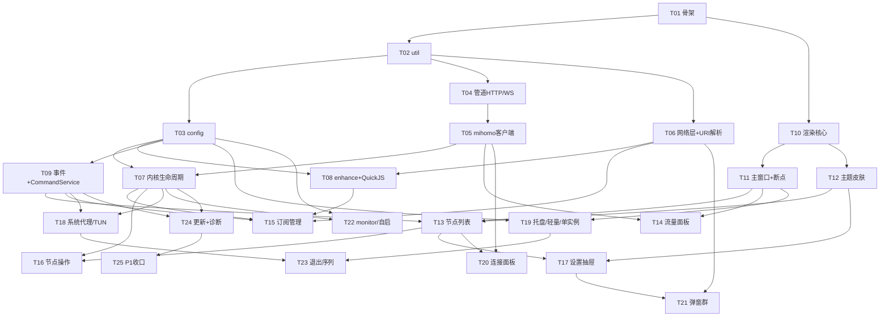

# ClashWin 任务分解（阶段二 · 下发工程师执行）

> 架构师 Bob · 2026-10-24。配套架构见 `05_cpp20_architecture.md`。
> 粒度原则：**每个任务 = 一次可编译、可链接、可冒烟的提交**；T01 为 Walking Skeleton；覆盖 PRD 全部 P0/P1；P2 六项不移植（用户裁定）。
> 每任务完成标准中的"对照"指与本机 Clash Mini（ClashVerge 构建）双开比对。
> 注：本项目规模（移植 ~23k 行 Rust + 230 文件前端）远超常规 5 任务上限，按主理人指令采用"每任务可编译提交"粒度，共 25 任务。

## 任务总表

| ID | 任务 | 依赖 | 优先级 | 行数量级 |
|----|------|------|--------|---------|
| T01 | 工程骨架 + Walking Skeleton | — | P0 | ~1.5k |
| T02 | util 基础库 | T01 | P0 | ~1.5k |
| T03 | config 配置体系 | T02 | P0 | ~2.5k |
| T04 | 管道 HTTP/WS 客户端层 | T02 | P0 | ~2k |
| T05 | mihomo 客户端（REST+WS 四通道） | T04 | P0 | ~2k |
| T06 | 网络层 + 通用 URI 解析器 | T02 | P0 | ~2.8k |
| T07 | 内核生命周期（Sidecar+Service） | T03, T05 | P0 | ~2.5k |
| T08 | enhance 配置流水线 + QuickJS | T03, T06 | P0 | ~3k |
| T09 | 事件总线 + CommandService 门面 | T03 | P0 | ~1.8k |
| T10 | UI 渲染核心 + Widget 树 + i18n | T01 | P0 | ~2.8k |
| T11 | 主窗口框架 + 断点状态机 | T10 | P0 | ~2k |
| T12 | 主题/皮肤参数系统 | T10 | P0 | ~1.5k |
| T13 | 节点列表场景（单 PROXY 组） | T11, T12, T09 | P0 | ~2k |
| T14 | 流量面板（WS→采样→增强图） | T11, T05 | P0 | ~1.5k |
| T15 | 订阅管理（下载/导入/激活/定时） | T07, T08, T06, T09 | P0 | ~2.5k |
| T16 | 节点操作服务（切换/测速/校准） | T07, T13 | P0 | ~1.5k |
| T17 | 设置抽屉 5 卡 + 语言/皮肤条 | T13, T12 | P0 | ~2.5k |
| T18 | 系统代理/TUN 注入/代理守护 | T07, T09 | P0 | ~1.8k |
| T19 | 托盘/轻量模式/单实例/深链 | T11, T03 | P0 | ~1.5k |
| T20 | 连接面板（snapshot+delta） | T13, T05 | P0 | ~1.8k |
| T21 | 弹窗群（向导/addurl/unlock/4 弹窗/只读查看器） | T17, T06 | P0 | ~2.5k |
| T22 | monitor 守护/自启对账/端口卫士 | T07, T03 | P0 | ~1.5k |
| T23 | 退出序列/信号/重启恢复 | T18, T19 | P0 | ~1k |
| T24 | 内核热升级 + 客户端自更新 + 诊断包 | T07, T09 | P1 | ~2k |
| T25 | P1 收口（服务增强/网络信息/runtime 工具/图标缓存/帮助菜单） | T24 | P1 | ~1.5k |

合计预估 ~4.4 万行 C++。

---

## 任务明细

### T01 工程骨架 + Walking Skeleton
- **文件**：`CMakeLists.txt`、`cmake/{deps,compiler,copy_resources}.cmake`、`CMakePresets.json`、`third_party/{yaml-cpp,quickjs,nlohmann}/`（vendored 落库）、`src/main.cpp`、`src/app/app.{h,cpp}`、`src/util/log.{h,cpp}`、`src/util/result.h`、`src/util/utf.{h,cpp}`、`src/clashwin.rc`、`src/app.manifest`
- **依赖**：无
- **完成标准**：① MSVC 一键构建出 `clashwin.exe`（静态 CRT）；② 启动打开 271×680 无框窗口，D2D 清屏底色 #F5F5F5，无告警退出；③ `logs/clashwin.log` 产生；④ 二次启动唤起首实例后自身退出（TCP 33335 抢占逻辑可先用桩）；⑤ 构建后 sidecar/ 与 resources/ 落到输出目录。
- **量级**：~1.5k

### T02 util 基础库
- **文件**：`src/util/{json_utils,yaml_utils,base64,str_utils,speed,parse_traffic,uuid,dirs}.{h,cpp}`、`include/clashwin/util/debounce.h`（各含单测文件 `tests/test_*.cpp`，用 `clashwin_test.exe` 跑）
- **依赖**：T01
- **完成标准**：① 单测全绿（base64 鲁棒解码用 universal_parser 样例；fix_dirty_url 用脏 URL 样例；dirs 便携/APPDATA 两分支）；② dirs 生成的路径与 Clash Mini app_home_dir 完全一致（对照实机目录名）。
- **量级**：~1.5k

### T03 config 配置体系
- **文件**：`src/config/{verge,clash,profiles,prfitem(仅本地部分),config,draft,migrate,window_state,proxy_head_state,unlock_cache}.{h,cpp}`、`include/clashwin/config/models.h`（§3.1 数据模型落位）、`include/clashwin/config/constants.h`
- **依赖**：T02
- **完成标准**：① 空环境启动生成 verge.yaml/config.yaml/profiles.yaml（含全局 Merge.yaml/Script.js 保护件），与 Clash Mini 首启产物逐字段 diff 为空；② 端口 0/越界回退与 controller 冲突寻位单测通过；③ window_state.json 1s 节流+尾随补写+版本号防乱序+0×0 守卫按常量表复刻并经窗口模拟测试；④ migrate 对 verge v2/v3 样例迁移前产生备份。
- **量级**：~2.5k

### T04 管道 HTTP/WS 客户端层
- **文件**：`src/mihomo/{http_types.h,pipe_http,pipe_ws}.{h,cpp}`、`tests/test_pipe_http.cpp`
- **依赖**：T02
- **完成标准**：① 用一个测试用命名管道服务端（测试内自起线程模拟 mihomo）完成 GET/POST/PUT/DELETE round-trip；② 连接池 min3/max16/idle30s 参数可配置且 BUSY 24×125ms 重试复现（模拟返回 BUSY）；③ WS Upgrade 握手+帧编解码（含 mask/分片/ping-pong）单测通过；④ 对真实 `\\.\pipe\clash-verge-service` 发 GET /version 与 GET /magic 得到合法响应（magic 串逐字符一致）。
- **量级**：~2k

### T05 mihomo 客户端
- **文件**：`src/mihomo/{mihomo_client,ws_manager}.{h,cpp}`、`include/clashwin/mihomo/models.h`（§3.2）
- **依赖**：T04
- **完成标准**：① 对实机 mini-mihomo（`-ext-ctl-pipe \\.\pipe\mini-mihomo` 手动拉起）完成 02§6 全部 REST 端点调用清单（脚本化逐条验证）；② WS 四通道连收数据且 traffic 载荷解析为 `{up,down,upTotal?,downTotal?}`；③ Bearer secret 鉴权生效（错 secret 返回 401 时报错分类正确）；④ clear_all_ws_connections/ws_disconnect 行为一致。
- **量级**：~2k

### T06 网络层 + 通用 URI 解析器
- **文件**：`src/system/{net_http}.{h,cpp}`、`src/enhance/uri_list.{h,cpp}`（universal_parser 2008 行全量移植）、`tests/test_uri_list.cpp`、`tests/test_ssrf.cpp`
- **依赖**：T02
- **完成标准**：① 用 ClashVerge 源中的测试样例/真实 URI 逐协议对照解析结果（vmess/ss/trojan/vless/hysteria2/hysteria/anytls/tuic/wireguard/socks5/http 兜底）字段一致；② Base64 三模式回退一致；③ SSRF：localhost/私网/链路本地/ULA 全拒，DNS 重绑定二次校验生效；④ 50MB 上限与 20s 超时生效；⑤ 直连节点导入产物（L_Direct_Imports.yaml 去重合并）与原版对照 diff 为空。
- **量级**：~2.8k

### T07 内核生命周期
- **文件**：`src/core/{core_manager,service_mode,validate}.{h,cpp}`、`src/mihomo/service_ipc.{h,cpp}`（正式落位）、`include/clashwin/core/constants.h`
- **依赖**：T03、T05
- **完成标准**：① Sidecar 模式拉起 sidecar/mini-mihomo.exe（-d -f -ext-ctl-pipe + GOMEMLIMIT/GOGC/GOMAXPROCS），进程命令行与原版一致（procexp 对照）；② 启动前 kill_all_mini_cores 扫杀残留生效；③ Service 模式：SCM 查询 clash_verge_service、start_clash payload 与 04§6 一致（{code,message,data} code>0 判失败）、SERVICE_WAIT 30s/200ms；④ validate：clash-mini-check.yaml + `-t` 10s，结果四分类；⑤ snapshot→reload(force)→restore 热应用；⑥ TUN 非管理员→必须走服务，服务未就绪→告警回退系统代理（禁止静默降级）。
- **量级**：~2.5k

### T08 enhance 配置流水线 + QuickJS
- **文件**：`src/enhance/{enhance,merge,seq,field,chain,tun,mini_agreements,dns_defaults,js_engine}.{h,cpp}`
- **依赖**：T03、T06
- **完成标准**（G3 最关键门禁）：① 同一订阅下，ClashWin 生成的 clash-mini.yaml 与 Clash Mini 实机产物**逐行 diff 为空**（含 PROXY/PROXY__METRICS 组、gfwlist RULE-SET 位置、DNS 对偶规则、GEOIP,CN、MATCH 兜底方向）；② 重名节点 ` #n (HHMMSS)` 后缀一致；③ Merge/Script（QuickJS 3s 超时看门狗）样例脚本执行结果一致；④ use_tun 注入/fake-ip/ipv6 防泄漏与 tun.rs 逐条对照；⑤ apply_mandatory_dns_settings 仅补缺不覆盖。
- **量级**：~3k

### T09 事件总线 + CommandService 门面
- **文件**：`src/events/{event_names.h,event_bus,notice}.{h,cpp}`、`src/cmd/{command_service,cmd_profile,cmd_clash,cmd_verge,cmd_system,cmd_service,cmd_lightweight,cmd_network,cmd_proxy}.{h,cpp}`（media/diagnostics 桩到 T21/T25）
- **依赖**：T03
- **完成标准**：① 事件名/防抖常量表与 01§5-C + 02§6 完全一致（250/250/200/800ms 等）；② 43 个 command 签名与 phase1 01§5-A 清单一一对应（缺一即不收）；③ 超时梯度 10/15/30/60s 落位；④ notice-service 50 条上限与 3000/5000/8000ms 自动消失；⑤ 轻 API 冒烟：get_profiles/get_verge_config/patch_verge_config 走通。
- **量级**：~1.8k

### T10 UI 渲染核心 + Widget 树 + i18n
- **文件**：`src/ui/{d2d_context,render_target,widget,container,label,button,icon_w,segmented,switch_w,textfield,slider,dropdown,checkbox_w,scroll_list,context_menu,modal,snackbar_w,tooltip_w,canvas_graph,text_viewer,ui_postbox}.{h,cpp}`、`src/i18n/{i18n}.{h,cpp}`、`assets/locales/`（13 语言从 ClashVerge 只读复制落库）
- **依赖**：T01
- **完成标准**：① Widget 树 demo：Column/Row/Stack/ScrollList/按钮/开关/滑块/下拉全部可交互渲染（demo 场景或测试 harness）；② 30fps 合帧 + 脏区合并（InvalidateRect 统计验证无全屏重绘）；③ 13 语言加载、fallback=zh、zh-cn/zh-tw 归一单测通过；④ DPI manifest 生效（100%/150% 下逻辑尺寸恒定）。
- **量级**：~2.8k

### T11 主窗口框架 + 断点状态机
- **文件**：`src/ui/{main_window,breakpoints,title_bar,main_scene}.{h,cpp}`
- **依赖**：T10
- **完成标准**：① 无框 271×680 窗口 + 30px 标题栏（图标/文字/三键 28×28、close hover 红）；② MINMAX 钳制 271×126~640×860、WM_SIZING 上缘钳制、8 方向拖拽边全部生效（与原版窗口缩放手感对照）；③ 宽≤285/高≤126 状态机转换触发 Widget 挂载卸载（日志验证）、流量栏 135→100；④ 大尺寸 □ toggle 640×860 且禁 OS maximize，恢复 last-non-large-size；⑤ 几何重启还原（window_state.json）。
- **量级**：~2k

### T12 主题/皮肤参数系统
- **文件**：`src/ui/{theme,skin_params,icon_store}.{h,cpp}`
- **依赖**：T10
- **完成标准**：① 亮暗两套色板 + 6 皮肤 × 控件族绘制参数表与 button-styles.ts 逐分支对照（3D 内阴影 ×depth×vibrancy）；② original 强制 hsl(239,26%,49%)；③ primary 未配置取系统 AccentColor；④ 背景图/blend/opacity 与极光动画层渲染正常；⑤ 皮肤切换即时生效（无重启）。
- **量级**：~1.5k

### T13 节点列表场景
- **文件**：`src/ui/{active_node_card,proxy_list}.{h,cpp}`、`src/ui/app_state.{h,cpp}`、`src/ui/delay_manager.{h,cpp}`
- **依赖**：T11、T12、T09
- **完成标准**：① 布局与 clashwin_pixel_perfect.png 对照：顶栏 30px 快捷条、过滤工具条 34px（⚡+排序+搜索框"过滤节点..."）、行高 39、分组头、选中橙高亮浅橙底；② 1000+ 假节点虚拟滚动流畅（fps 计数）；③ 极小窗卸载列表；④ DelayManager TTL 30min/判死 30-2000ms/批量注入按常量表。
- **量级**：~2k

### T14 流量面板
- **文件**：`src/ui/{traffic_panel,traffic_sampler}.{h,cpp}`
- **依赖**：T11、T05
- **完成标准**：① 双折线（↓蓝 #0A84FF/↑紫）maxPoint 30、10fps；② 宽>285 挂增强图（10min 原始+60min 压缩采样链路完整）、≤285 退简易图；③ 速率两行与截图版式一致（↓: 180.2 KB/s 样式、总计右对齐）；④ 50ms 去重/1s 节流生效；⑤ 失焦停采开关生效。
- **量级**：~1.5k

### T15 订阅管理
- **文件**：`src/cmd/cmd_profile.cpp` 完整实现、`src/config/prfitem.cpp` 网络部分、`src/core/timer.{h,cpp}`、`src/ui/profile_import_card.{h,cpp}`
- **依赖**：T07、T08、T06、T09
- **完成标准**：① 双开对照：同一 URL 导入后 profiles.yaml、下载文件、extra 流量信息 diff 为空；② 三级解析回退（构造三种样例验证）；③ 首次导入自动激活 + enhance_profiles→ValidationOutcome 四分类；④ patch_profiles_config 切换失败自动回滚 previous；⑤ 右键菜单（更新/编辑/删除/置顶）功能一致；⑥ 定时更新默认 1440min、过期补跑、失败 2min 重试、与切换互斥。
- **量级**：~2.5k

### T16 节点操作服务
- **文件**：`src/cmd/cmd_clash.cpp`/`cmd_proxy.cpp` 完整实现、`src/ui/proxy_list.cpp` 交互接线、`src/ui/delay_manager.cpp` 完整
- **依赖**：T07、T13
- **完成标准**：① 点击节点切换（PUT /proxies/PROXY）后重启 ClashWin，选择保持（store-selected）；② TEST 全组测速：后端群发+择优、backend-delay-results 批量注入上色；③ test_delay 失败 10000/超时 2000；④ 激活三重校准防线（子集校验+失败回写内核实际节点）注入测试生效；⑤ 唤醒静默测速 5min 冷却+互斥锁。
- **量级**：~1.5k

### T17 设置抽屉 5 卡 + 语言/皮肤条
- **文件**：`src/ui/{settings_drawer,profile_import_card 组件化重构(若在 T15 已建则只接线),takeover_card,routing_card,basic_card,theme_card}.{h,cpp}`
- **依赖**：T13、T12
- **完成标准**：① 与 clashwin_drawer.png 逐区域对照（左列 240px、卡片标题、三段开关选中态白底橙字粗体、2×2 开关、Mixed Port 输入+保存、Depth/Vibrancy 滑块带数值）；② 右侧连接面板宽≤285 不挂载；③ 皮肤条高≤830 隐藏；④ 语言下拉切换即时生效并 patchVerge({language})；⑤ 每卡操作 → 对应 command 调用链验证。
- **量级**：~2.5k

### T18 系统代理/TUN 注入/代理守护
- **文件**：`src/system/{sysproxy,guard_monitor}.{h,cpp}`、`src/cmd/cmd_network.cpp` 完整、`src/enhance/tun.cpp` 集成验证
- **依赖**：T07、T09
- **完成标准**：① 开关系统代理后：LAN + 每个 RAS 条目（RasEnumEntriesW）的 PER_CONN_OPTION 状态与原版一致（注册表读回对照）；② 广播 PROXY_SETTINGS_CHANGED+REFRESH 生效（浏览器立即感知）；③ 默认 bypass 串逐字符一致，自定义 bypass 追加/替换；④ PAC 模式 AutoConfigURL=:33335/commands/pac，顺序规则（纯全局先清 PAC；PAC 模式反之）；⑤ GuardMonitor 30s 重写防篡改（手动改注册表后 30s 内复原）；⑥ TUN 开关注入配置（fake-ip/inet6）后内核生效。
- **量级**：~1.8k

### T19 托盘/轻量模式/单实例/深链
- **文件**：`src/system/tray.{h,cpp}`、`src/app/{singleton,scheme}.{h,cpp}`、`src/app/lifecycle.cpp`（轻量模式部分）、`src/cmd/cmd_lightweight.cpp`
- **依赖**：T11、T03
- **完成标准**：① 托盘 2 项（轻量模式勾选态/退出）、三态图标随 TUN>系统代理>默认切换、tooltip "Clash Mini"、左键唤醒 300ms 防抖；② 关闭按钮→隐藏+轻量模式（D2D 资源释放+断 WS，内存占用可测量下降）→托盘恢复重建；③ 二实例启动唤起首实例并退出；④ `clash://install-config?url=...` 导入订阅且仅此前无 current 才强制更新配置；⑤ /commands/pac 返回正确 PAC 文本（%mixed-port% 替换）。
- **量级**：~1.5k

### T20 连接面板
- **文件**：`src/ui/{connections_panel,connection_store}.{h,cpp}`
- **依赖**：T13、T05
- **完成标准**：① snapshot+delta 协议：构造乱序/跨 epoch 数据触发全量 resync（单测注入）；② closed 上限 500；③ 列管理/排序/右键复制/断开单条/断开全部与原版一致；④ 详情 Popover 字段齐全（chains 规则链）；⑤ 窄窗不挂载、极小窗不订阅。
- **量级**：~1.8k

### T21 弹窗群
- **文件**：`src/ui/{dialogs,add_url_dialog,unlock_dialog,log_dialog}.{h,cpp}`、`src/cmd/cmd_media.cpp`、`src/system/unlock_checker.{h,cpp}`、`src/system/unlock_platforms.cpp`、`src/config/unlock_cache.cpp` 接线
- **依赖**：T17、T06
- **完成标准**：① 首启向导：无订阅+未完成时延迟 500ms 弹出、两步 input→ready 轮询、20s 超时降级、"稍后"开抽屉、完成标记持久化；② addurl 弹窗（360×290 版式对照）写入自定义分流后 enhance 产物规则行一致；③ 解锁弹窗（360×620）：12 项并发检测、缓存显示 clash_verge_unlock_results/time、重检按钮；④ 编辑/客户端更新/内核更新/日志 4 弹窗可用，日志 50ms 合批/1000 条上限；⑤ 只读文本查看器 + "用系统编辑器打开"。
- **量级**：~2.5k

### T22 monitor 守护/自启对账/端口卫士
- **文件**：`src/core/{monitor,autostart}.{h,cpp}`、集成 `src/config/clash.cpp` 端口卫士
- **依赖**：T07、T03
- **完成标准**：① 手杀内核进程 → 按常量节奏（15s 体检/判死 3s/离线 5s、连续 2 次判死自愈、3 次 restart_core、5 次 MessageBoxW）自动恢复且节点选择恢复；② 开机自启：注册表键 "Clash Mini" 带 --silent，reconcile_on_startup 对账，schtasks 一次性清理标记；③ 端口 0/越界回退、controller 冲突自动寻 9098 起空闲口实测。
- **量级**：~1.5k

### T23 退出序列/信号/重启恢复
- **文件**：`src/app/lifecycle.{h,cpp}` 完整、`src/system/signals.{h,cpp}`
- **依赖**：T18、T19
- **完成标准**：① quit 序列与 04§7 逐行一致（prepare_exit→并行 proxy/core 清理→flush→exit code 语义）；② 退出后：系统代理复位（含 RAS）、内核进程停止、33335 关闭、三份配置落盘；③ Ctrl+C/关机/注销触发同样清理；④ restart_app 快照恢复节点（90s 预算）+ 窗口几何一致；⑤ 任务管理器结束 Explorer 无泄漏进程。
- **量级**：~1k

### T24 内核热升级 + 客户端自更新 + 诊断包
- **文件**：`src/core/core_updater.{h,cpp}`、`src/update/{client_updater,update_check}.{h,cpp}`、`src/cmd/cmd_diagnostics.cpp`
- **依赖**：T07、T09
- **完成标准**：① check_core_update 对 GitHub mihomo latest 拿到版本号（与原版同 API）；② start_core_upgrade：下载→sha256→热替换 cores/mini-mihomo.exe，进度事件 checking(5)→downloading(10-84)→verifying(85)→extracting(90)→done(100)/error(0) 逐态发 core-upgrade-progress；③ 客户端自更新 check/download/install（若 §10-1 裁定为仅检查则相应降级验收）；④ export_diagnostic_bundle 内容清单与原版对照。
- **量级**：~2k

### T25 P1 收口
- **文件**：`src/cmd/cmd_service.cpp`（reinstall/repair）、`src/cmd/cmd_network.cpp`（接口信息/hostname）、`src/cmd/`runtime 工具命令、`src/system/{shell_utils,icon_cache}.{h,cpp}`、`src/ui/main_scene.cpp` 帮助菜单接线、`src/util/dirs.cpp` 便携模式终验
- **依赖**：T24
- **完成标准**：① reinstall_service/repair_service 可用；② get_network_interfaces(_info)/hostname 输出与原版一致；③ get_runtime_yaml/exists/logs 三命令；④ 图标缓存 download/copy + 节点图标显示；⑤ 帮助菜单全项（检查更新×2/导出诊断/打开目录/Wiki/重看向导）；⑥ 便携模式 exe 同级 .config 目录分支实测。
- **量级**：~1.5k

---

## 依赖图

**可并行轨道**（供排期参考）：
- 轨道 A（通信/后端）：T02→T04→T05→T07→T15/T16…
- 轨道 B（配置/增强）：T02→T03→T08→T15
- 轨道 C（UI）：T01→T10→T11/T12→T13/T14/T17…
- 关键汇合点：T15（A+B+C 汇合）、T23（退出=全功能串联验收点）。

**里程碑**：
- M1（T01-T07 完成）：Walking Skeleton→无头内核可被原生进程完整管理；
- M2（T08-T14）：主窗口三要素（节点/流量/主题）像素对照通过；
- M3（T15-T20）：P0 功能全绿，双开脚本化对照通过；
- M4（T21-T25）：P0/P1 全量收口 + PRD §附验收清单全项通过。
